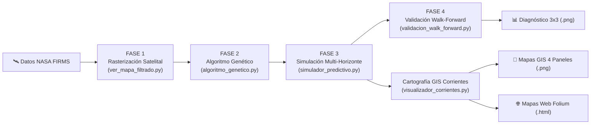

# Modelado Fractal y Simulación Predictiva de Incendios Forestales

> **Aplicación al Megaincendio de Corrientes (Argentina, 2022)**  
> Sistema de **Optimización Inversa** mediante **Algoritmos Genéticos** y **Autómatas Celulares**, con transposición cartográfica vectorial interactiva y estática sobre la provincia de Corrientes.

---

## 📌 1. Visión General del Proyecto

A principios de 2022, la provincia de Corrientes sufrió una de las mayores catástrofes ecológicas de su historia, perdiendo más de un millón de hectáreas en los Esteros del Iberá y campos productivos. Debido a la escasez de estaciones meteorológicas en áreas remotas del humedal, resultaba casi imposible conocer el microclima exacto (viento en superficie, humedad del combustible) en el frente de fuego.

Este sistema implementa una **estrategia científica de optimización inversa**:

1. Extrae las cicatrices reales del fuego capturadas por sensores satelitales de la NASA (VIIRS/MODIS).
2. Cuantifica la rugosidad geométrica perimetral mediante la **Dimensión Fractal ($D$)** por Box-Counting.
3. Utiliza un **Algoritmo Genético Multitemporal** para deducir qué variables microclimáticas (velocidad del viento, dirección azimutal, humedad relativa y carga de combustible) originaron esa evolución geométrica.
4. Con las variables óptimas inferidas, un **Autómata Celular Estocástico** proyecta el avance continuo del fuego a través de tres horizontes temporales clave (**$+24\text{h}$ táctico**, **$+48\text{h}$ preventivo** y **$+72\text{h}$ estratégico**), generando **matrices de riesgo isócronas acumulativas**.
5. **Transpone las matrices fractales** a coordenadas geográficas reales sobre el mapa de los 25 departamentos de la provincia de Corrientes y sobre la República Argentina en figuras GIS estáticas de 4 paneles (300 DPI) y mapas web interactivos multicapa con Folium.

---

## 🚀 2. Pipeline en 4 Fases



1. **Fase 1: Extracción y Filtrado Satelital (`ver_mapa_filtrado.py`):**
   Filtra los focos en el área de Corrientes ($\text{Lat } [-30.8^\circ, -27.2^\circ], \text{Lon } [-59.8^\circ, -55.6^\circ]$), rasteriza a grilla de $256 \times 256$ celdas, aplica dilatación morfológica física calibrada (1 iteración, $r \approx 1.6\text{ km}$) y preserva integralmente el 100% de los focos multicluster observados por la NASA.
2. **Fase 2: Optimización Inversa Multitemporal (`algoritmo_genetico.py`):**
   Evoluciona una población de hipótesis climáticas en paralelo (`ProcessPoolExecutor`), evaluando el fitness híbrido multitemporal ($50\%$ Dimensión Fractal directa $+ 50\%$ Cobertura Eficiente Espacial $F_1$-Dice) frente a la serie temporal de observaciones satelitales instantáneas.
3. **Fase 3: Simulación Predictiva Multi-Horizonte (`simulador_predictivo.py`):**
   A partir de los focos activos instantáneos de partida ($M_{\text{base}}$), encadena la propagación continua en tres etapas ($M_{\text{base}} \xrightarrow{+30} M_{24\text{h}} \xrightarrow{+30} M_{48\text{h}} \xrightarrow{+30} M_{72\text{h}}$) y construye la matriz isócrona de riesgo.
4. **Fase 4: Validación Fuera de Muestra Walk-Forward (`validacion_walk_forward.py`):**
   Evalúa prospectivamente la capacidad predictiva ciega a +24h, +48h y +72h contrastando el autómata celular contra las observaciones satelitales instantáneas de los días posteriores de la NASA.

---

## 🛠️ 3. Instalación y Requisitos

Se recomienda utilizar Python 3.10 o superior en un entorno virtual:

```bash
# Clonar el repositorio
git clone https://github.com/ConstanFinelli/Incendios-Fractales.git
cd Incendios-Fractales

# Crear y activar entorno virtual
python3 -m venv .venv
source .venv/bin/activate  # En Windows: .venv\Scripts\activate

# Instalar dependencias
pip install -r requirements.txt
```

---

## 💻 4. Guía de Uso Rápido

Ejecuta el orquestador interactivo:

```bash
python main.py
```

El programa te solicitará las fechas a analizar:

- **Fecha Inicial:** `2022-02-16` (o cualquier fecha pico del desastre, ej. `2022-02-18`).
- **Fecha Final:** `2022-02-17` (opcional; presiona Enter para calibrar automáticamente hacia el día siguiente).

### 📁 Salidas Generadas (en `output/`)

- 📊 **`output/walk_forward_comparativa_3dias.png`**: Matriz diagnóstica espacial ($3 \times 3$) de validación científica ciega a +24h, +48h y +72h contra la verdad satelital NASA con mapa departamental de Corrientes (300 DPI).
- 📈 **`output/walk_forward_metricas_progression.png`**: Curva de evolución temporal de métricas prospectivas ($F_1$-Dice, Recall, Precision, IoU, Error $\Delta D$).
- 📑 **`output/reporte_walk_forward_3dias.csv`**: Reporte cuantitativo tabular fuera de muestra con métricas espaciales y climáticas.
- 🗺️ **`output/mapa_riesgo_predictivo.png`**: Matriz comparativa de riesgo isócrono del autómata celular (4 paneles en alta resolución a 300 DPI: Focos Activos Base, Predicción +24h Táctica, Predicción +48h Preventiva y Predicción +72h Estratégica).
- 📍 **`output/mapa_corrientes_prediccion.png`**: Figura cartográfica GIS (300 DPI) estructurada en 4 paneles horizontales georreferenciados sobre los 25 departamentos de Corrientes, con rótulos de texto protegidos por halo blanco (`path_effects`).
- 🌐 **`output/mapa_corrientes_interactivo.html`**: Mapa web interactivo de Corrientes desarrollado en Folium con teselas conmutables (**CartoDB Positron**, **OpenStreetMap**, **Satélite Esri World Imagery**), tooltips por departamento y capas conmutables autónomas en Base64 para cada horizonte temporal (+24h, +48h, +72h e Isócronas).
- 🌿 **`output/mapa_cobertura_combustible.png`**: Mapa de cobertura vegetal y susceptibilidad de combustible biofísico derivado del geoservicio WFS del IGN con 4 clases ecológicas (Tarea T2.1).
- 💾 **`output/npy/matriz_objetivo_limpia_AAAA-MM-DD.npy`**: Subcarpeta de matrices binarias satelitales filtradas de la NASA (VIIRS/MODIS).
- 🖼️ **`output/siluetas/silueta_fractal_limpia_AAAA-MM-DD.png`**: Subcarpeta de siluetas fractales procesadas.

---

## 📂 5. Estructura del Proyecto

```
Incendios-Fractales/
├── main.py                          # Orquestador interactivo de punta a punta
├── ver_mapa_filtrado.py             # Ingesta, recorte y rasterización satelital (Fase 1)
├── algoritmo_genetico.py            # Optimización inversa multitemporal (Fase 2)
├── calcular_dimension_fractal.py    # Extracción de perímetro y Box-Counting (D)
├── automata_celular.py              # Motor físico de simulación de incendios
├── capa_biomasa.py                  # Capa de biomasa y combustible IGN WFS (Tarea T2.1)
├── simulador_predictivo.py          # Proyección de riesgo preventivo (Fase 3)
├── validacion_walk_forward.py       # Protocolo científico de validación ciega fuera de muestra
├── visualizador_corrientes.py       # Cartografía departamental de Corrientes (Fase 4)
├── requirements.txt                 # Dependencias del ecosistema Python
├── docs/
│   ├── DOCUMENTACION_COMPLETA_PROYECTO.md  # Manual exhaustivo y catálogo de funciones
│   ├── conclusion_walk_forward.md          # Informe científico del protocolo Walk-Forward
│   ├── estrucura_documentacion.md          # Guía y estándar de documentación del repositorio
│   ├── non_implemented_plans/              # Planes archivados para fases futuras
│   └── files/                              # Especificación modular detallada por componente
└── output/                                 # Mapas, matrices e informes generados
    ├── npy/                                # Matrices binarias satelitales (.npy)
    └── siluetas/                           # Siluetas fractales limpias (.png)
```

---

## 📚 6. Documentación Detallada

Para una explicación pormenorizada de cada función, derivaciones matemáticas del autómata celular, justificación física de los rangos microclimáticos y decisiones de diseño cartográfico, consulta la [Documentación Integral del Proyecto](docs/DOCUMENTACION_COMPLETA_PROYECTO.md).
