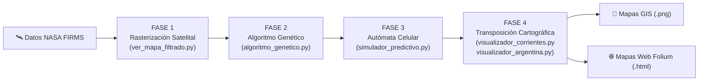

# Modelado Fractal y Simulación Predictiva de Incendios Forestales

> **Aplicación al Megaincendio de Corrientes (Argentina, 2022)**  
> Sistema de **Optimización Inversa** mediante **Algoritmos Genéticos** y **Autómatas Celulares**, con transposición cartográfica vectorial interactiva y estática sobre la provincia de Corrientes.

---

## 📌 1. Visión General del Proyecto

A principios de 2022, la provincia de Corrientes sufrió una de las mayores catástrofes ecológicas de su historia, perdiendo más de un millón de hectáreas en los Esteros del Iberá y campos productivos. Debido a la escasez de estaciones meteorológicas en áreas remotas del humedal, resultaba casi imposible conocer el microclima exacto (viento en superficie, humedad del combustible) en el frente de fuego.

Este sistema implementa una **estrategia científica de optimización inversa**:
1. Extrae las cicatrices reales del fuego capturadas por sensores satelitales de la NASA (VIIRS/MODIS).
2. Cuantifica la rugosidad geométrica perimetral mediante la **Dimensión Fractal ($D$)** por Box-Counting.
3. Utiliza un **Algoritmo Genético Multitemporal** para deducir qué variables microclimáticas (velocidad del viento, dirección azimutal, humedad relativa y carga de combustible) originaron esa evolución geométrica.
4. Con las variables óptimas inferidas, un **Autómata Celular Estocástico** proyecta el avance del fuego hacia el futuro ($+N$ ciclos) generando **mapas de riesgo preventivo**.
5. **Transpone las matrices fractales** a coordenadas geográficas reales sobre el mapa de los 25 departamentos de la provincia de Corrientes (en formatos GIS estático de alta resolución y web interactivo).

---

## 🚀 2. Pipeline en 4 Fases



1. **Fase 1: Extracción y Filtrado Satelital (`ver_mapa_filtrado.py`):**
   Filtra los focos en el área de Corrientes ($\text{Lat } [-30.8^\circ, -27.2^\circ], \text{Lon } [-59.8^\circ, -55.6^\circ]$), rasteriza a grilla de $256 \times 256$ celdas, aplica dilatación morfológica y limpia islas de ruido aisladas.
2. **Fase 2: Optimización Inversa Multitemporal (`algoritmo_genetico.py`):**
   Evoluciona una población de hipótesis climáticas en paralelo (`multiprocessing`), evaluando el fitness híbrido multitemporal ($0.4 \cdot \text{Fractal} + 0.6 \cdot \text{IoU}$) frente a la serie temporal de observaciones satelitales.
3. **Fase 3: Simulación Preventiva (`simulador_predictivo.py`):**
   Alimenta el autómata celular optimizado (`automata_celular.py`) con la última cicatriz observada y las variables inferidas para proyectar el riesgo de avance.
4. **Fase 4: Transposición Cartográfica Territorial (`visualizador_corrientes.py` y `visualizador_argentina.py`):**
   Georreferencia las matrices sobre los 25 departamentos de Corrientes y sobre el territorio de la República Argentina (contexto continental nacional y zoom regional Litoral/Mesopotamia), genera mapas estáticos GIS a 300 DPI, construye visores web interactivos en Folium con capas satelitales y reporta departamentos bajo riesgo de avance.

---

## 🛠️ 3. Instalación y Requisitos

Se recomienda utilizar Python 3.10 o superior en un entorno virtual:

```bash
# Clonar el repositorio
git clone https://github.com/ConstanFinelli/Incendios-Fractales.git
cd Incendios-Fractales

# Crear y activar entorno virtual
python3 -m venv .venv
source .venv/bin/activate  # En Windows: .venv\Scripts\activate

# Instalar dependencias
pip install -r requirements.txt
```

---

## 💻 4. Guía de Uso Rápido

Ejecuta el orquestador interactivo:

```bash
python main.py
```

El programa te solicitará las fechas a analizar:
- **Fecha Inicial:** `2022-02-17` (o cualquier fecha pico del desastre, ej. `2022-02-18`).
- **Fecha Final:** `2022-02-19` (opcional; presiona Enter para analizar solo el día inicial).

### 📁 Salidas Generadas (en `output/`)

- 📍 **`output/mapa_corrientes_prediccion.png`**: Figura cartográfica multipanel (300 DPI) con foco inicial, predicción de avance y mapa de riesgo integrado sobre los 25 departamentos de Corrientes con rótulos protegidos por halo blanco.
- 🌐 **`output/mapa_corrientes_interactivo.html`**: Mapa web interactivo de Corrientes desarrollado en Folium con teselas conmutables (**CartoDB Positron**, **OpenStreetMap**, **Satélite Esri World Imagery**), tooltips por departamento y capas de fuego georreferenciadas autónomas (Base64).
- 🇦🇷 **`output/mapa_argentina_prediccion.png`**: Figura cartográfica GIS (300 DPI) con 3 paneles análogos a Corrientes (Foco Inicial, Predicción de Avance y Mapa de Riesgo Integrado) sobre el mapa completo de la República Argentina, manteniendo la misma vista nacional sin acercamientos ni distorsiones de enfoque.
- 🌐 **`output/mapa_argentina_interactivo.html`**: Mapa web interactivo en Folium de la República Argentina con división provincial oficial, capas satelitales, minimapa y leyenda climatológica flotante.
- 📊 **`output/mapa_riesgo_predictivo.png`**: Matriz comparativa de riesgo del autómata celular.
- 💾 **`output/matriz_objetivo_limpia_AAAA-MM-DD.npy`**: Matrices binarias satelitales filtradas.

---

## 📂 5. Estructura del Proyecto

```
Incendios-Fractales/
├── main.py                          # Orquestador interactivo de punta a punta
├── ver_mapa_filtrado.py             # Ingesta, recorte y rasterización satelital (Fase 1)
├── algoritmo_genetico.py            # Optimización inversa multitemporal (Fase 2)
├── calcular_dimension_fractal.py    # Extracción de perímetro y Box-Counting (D)
├── automata_celular.py              # Motor físico de simulación de incendios
├── simulador_predictivo.py          # Proyección de riesgo preventivo (Fase 3)
├── visualizador_corrientes.py       # Cartografía departamental de Corrientes (Fase 4)
├── visualizador_argentina.py        # Cartografía nacional y regional de Argentina (Fase 4)
├── requirements.txt                 # Dependencias del ecosistema Python
├── docs/
│   ├── DOCUMENTACION_COMPLETA_PROYECTO.md  # Manual exhaustivo y catálogo de funciones
│   └── conclusion_validacion_modelo.md     # Validación científica y contrastación física
└── output/                          # Mapas, matrices e imágenes generadas
```

---

## 📚 6. Documentación Detallada

Para una explicación pormenorizada de cada función, derivaciones matemáticas del autómata celular, justificación física de los rangos microclimáticos y decisiones de diseño cartográfico, consulta la [Documentación Integral del Proyecto](docs/DOCUMENTACION_COMPLETA_PROYECTO.md).
