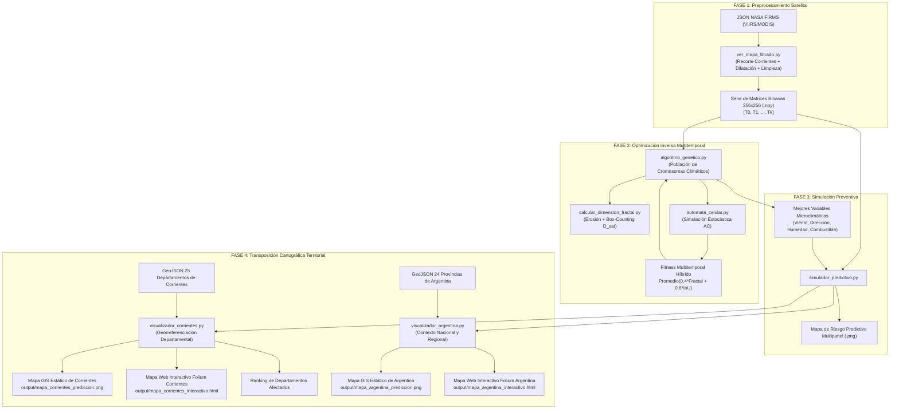

# Documentación Integral del Proyecto: Modelado Fractal y Predicción de Incendios mediante Algoritmos Genéticos

Este documento presenta una explicación completa, pedagógica y estructurada de todo el código y la arquitectura del sistema. Está diseñado para que cualquier persona que se incorpore al proyecto pueda comprender desde cero cómo surgió la investigación, cómo funciona cada módulo y el detalle exacto de todas las funciones implementadas.

---

## 1. Contexto, Origen y Motivación del Proyecto

### 1.1. La Problemática Real (Megaincendios de Corrientes 2022)

A principios de 2022, la provincia de Corrientes (Argentina) sufrió una catástrofe socioecológica en la que el fuego consumió más de un millón de hectáreas, afectando gravemente los Esteros del Iberá y zonas productivas.

Durante la catástrofe, los equipos de brigadistas tuvieron dificultades operativas para anticipar el avance del fuego debido a:

1. **Comportamiento no lineal y caótico:** El fuego no avanza como un círculo o elipse perfecto; interactúa con parches de vegetación seca, cuerpos de agua fragmentados y ráfagas de viento, formando patrones ramificados con **geometría fractal** (auto-similaridad y alta rugosidad perimetral).
2. **Falta de estaciones meteorológicas locales:** En el humedal, la estación climática más cercana puede estar a más de 50 km, impidiendo conocer el microclima exacto (velocidad y dirección real del viento en superficie, humedad del combustible) en el punto crítico del fuego.

### 1.2. La Solución Científica: Optimización Inversa

En lugar de intentar "adivinar" el clima para simular el fuego, el proyecto plantea el camino inverso (**Optimización Inversa**):

- Tomar las fotografías satelitales reales del incendio provistas por la NASA (sensores VIIRS/MODIS).
- Medir la **rugosidad geométrica (Dimensión Fractal $D$)** y la **forma espacial** de la mancha satelital.
- Usar un **Algoritmo Genético (AG)** para deducir qué combinación de viento, dirección, humedad y combustible fue la causante de que el fuego adoptara esa silueta fractal específica.
- Una vez inferidas las variables óptimas, alimentar un **Autómata Celular (AC)** para proyectar hacia el futuro y generar **Mapas de Riesgo Predictivos**.

---

## 2. Diagrama de Flujo y Pipeline del Sistema



---

## 3. Convenciones Físicas, Matemáticas y de Modelado

Para que el modelo computacional sea fiel a las leyes de la física y a la ecología de los incendios forestales, el sistema adopta una serie de convenciones rigurosamente fundamentadas:

### 3.1. Dirección del Viento en Grados Sexagesimales (\(0^\circ - 360^\circ\))

- **Estándar Meteorológico (Rosa de los Vientos):** En las estaciones del INTA y sensores oficiales, la dirección del viento se mide en grados de azimut (\(0^\circ / 360^\circ = \text{Norte}\), \(90^\circ = \text{Este}\), \(180^\circ = \text{Sur}\), \(270^\circ = \text{Oeste}\)). Esto permite contrastar directamente las variables inferidas por el AG contra los registros climáticos históricos de febrero de 2022.
- **Espacio Continuo para el AG:** Permite al Algoritmo Genético afinar el ángulo con precisión decimal continua (ej. \(181.4^\circ\)) en lugar de limitarse a 4 u 8 puntos cardinales discretos.
- **Modelado Trigonométrico en el Autómata Celular:** Para cada celda vecina en la vecindad de Moore, se calcula el ángulo geométrico hacia ella (\(\theta*{\text{vecino}} = \text{arctan2}(-dy, dx)\)) y se evalúa la alineación con el viento mediante el coseno:
  $$\text{alineacion} = \cos(\theta*{\text{viento}} - \theta*{\text{vecino}})$$
  $$\text{Factor Viento} = e^{c \cdot v*{\text{viento}} \cdot \text{alineacion}}$$
  - A favor del viento (\(\Delta\theta = 0^\circ, \cos=1\)): Máxima aceleración y probabilidad (\(e^{+c \cdot v}\)).
  - Perpendicular (\(\Delta\theta = 90^\circ, \cos=0\)): Propagación lateral neutra (\(e^0 = 1\)).
  - En contra (\(\Delta\theta = 180^\circ, \cos=-1\)): Fuerte resistencia al avance (\(e^{-c \cdot v}\)).

---

### 3.2. Rango de Velocidad del Viento (\(0 - 50\text{ km/h}\))

- **Evidencia Meteorológica Real (Corrientes 2022):** En los registros históricos del INTA para enero-febrero de 2022, los vientos medios sostenidos oscilaron entre \(15\) y \(35\text{ km/h}\), mientras que las ráfagas máximas críticas alcanzaron picos de \(45\) a \(55\text{ km/h}\). Vientos sostenidos superiores a \(50\text{ km/h}\) corresponden a temporales severos (Escala Beaufort 7 a 8), sumamente atípicos en días secos y despejados sin tormenta. El rango \([0, 50]\) cubre el \(99.9\%\) de las condiciones reales del desastre.
- **Saturación Matemática en el Autómata Celular:** En la ecuación del AC, el factor del viento crece exponencialmente:
  $$\text{Factor Viento} = e^{0.05 \cdot v_{\text{viento}} \cdot \cos(\Delta\theta)}$$
  A \(v = 50\text{ km/h}\), el factor multiplicador a favor del viento es \(e^{2.5} \approx 12.18\times\), lo que satura la probabilidad de ignición al tope máximo permitido por el simulador (\(95\%\)). Permitir velocidades mayores (ej. \(80-100\text{ km/h}\)) crearía una "zona ciega" donde el AG no podría distinguir entre valores porque todos producirían exactamente el mismo avance saturado al \(95\%\), perdiendo gradiente de optimización.
- **Resolución Espacial y Estabilidad:** En una grilla de \(256 \times 256\) donde cada celda representa \(\sim 2-3\text{ km}\), una velocidad de \(50\text{ km/h}\) permite avanzar \(60-90\text{ km/día}\) en 30 pasos de simulación, coincidiendo con la tasa de expansión récord real y evitando que el frente escape o se desborde fuera de la matriz.

---

### 3.3. Rango de Humedad Relativa (\(10\% - 80\%\))

- **Límite Inferior (\(10\%\)):** Representa el escenario de sequía extrema y ola de calor crítica durante el fenómeno de _La Niña_ en Corrientes 2022. Humedades menores son físicamente inexistentes en el bioma de humedales y pastizales del litoral.
- **Límite Superior (\(80\%\) - Humedad de Extinción):** En ciencias forestales, cuando la humedad ambiente supera el \(75\%-80\%\), la vegetación absorbe tanta agua que la combustión no puede autosostenerse: **el fuego se extingue naturalmente**. Explorar humedades mayores en el AG sería inviable porque el fuego moriría en el primer paso.
- **Efecto Matemático:** El factor de sequedad en el AC se calcula como \((1.0 - \text{humedad}/100) \in [0.20, 0.90]\).

---

### 3.4. Rango de Combustible (\(0.1 - 1.0\)) y Distinción entre Nivel Local vs. Global

Es fundamental distinguir entre el combustible a nivel local (celda por celda) y el gen de combustible a nivel macro (Algoritmo Genético):

1. **Combustible Local (Celda puntual) — SÍ puede y debe llegar a 0:**
   - Cuando la vegetación de una celda se quema por completo, pasa a **Cenizas (Estado 2)**. Al convertirse en ceniza, su combustible local se agota (\(=0\)) y queda inerte para siempre.
   - Cuerpos de agua (ríos, lagunas del Iberá) o cortafuegos tienen combustible local \(=0\) y actúan como barreras infranqueables.
2. **Combustible Global (Gen del AG) — NO puede ser 0 (\(0.1 - 1.0\)):**
   - El gen del cromosoma representa la **densidad y tipo de biomasa macroscópica de todo el ecosistema de la región** (pastizales densos \(=1.0\), monte ralo \(=0.4\), etc.).
   - Si el gen fuera \(0.0\), significaría que en las 65.536 celdas del mapa no existe ni una sola brizna de pasto en ningún lado (un desierto estéril o mar abierto), en cuyo caso el incendio real detectado por el satélite nunca habría podido existir.
   - El piso de \(0.1\) asegura que siempre exista un mínimo de vegetación para evaluar la dinámica geométrica.

---

### 3.5. Estados de Celda en el Autómata Celular y el Rol de las Cenizas

El simulador implementa 3 estados físicos:

- **Estado 0:** Vegetación Intacta (Combustible disponible para quemar).
- **Estado 1:** Fuego Activo (Ardiendo y contagiando a vecinos intactos).
- **Estado 2:** Cenizas / Zona Quemada (Combustible agotado, celda inerte).

**¿Por qué las cenizas son críticas?**

1. **Evitan bucles infinitos:** Si una celda no pasara a ceniza y volviera a estado intacto (0), el fuego retrocedería y se re-quemaría sobre sí mismo indefinidamente.
2. **Forman el anillo o frente de fuego real:** El incendio avanza como una onda expansiva periférica (frente activo en los bordes, interior consumido e inerte).
3. **Continuidad multitemporal día a día:** Lo que se quemó el Día 1 pasa a ser ceniza inerte el Día 2; el fuego del Día 2 solo avanza sobre la vegetación verde que aún rodea el perímetro.
4. **Medición Fractal:** El área total afectada ($1+2$) permite extraer el perímetro exterior exacto de la cicatriz satelital mediante Box-Counting.

---

### 3.6. Delimitación Territorial, Georreferenciación y Resolución Espacial de Corrientes

Para conectar las simulaciones fractales teóricas con la gestión operativa y territorial del riesgo, el sistema define un sistema de georreferenciación estricto sobre la provincia de Corrientes:

- **Coordenadas de la Zona de Estudio (Bounding Box):**
  $$\text{LAT}_{\min} = -30.8^\circ, \quad \text{LAT}_{\max} = -27.2^\circ \quad (\text{Sur a Norte})$$
  $$\text{LON}_{\min} = -59.8^\circ, \quad \text{LON}_{\max} = -55.6^\circ \quad (\text{Oeste a Este})$$
  Esta delimitación geográfica encuadra de forma óptima los $88.886\text{ km}^2$ de la provincia de Corrientes, desde el límite con Entre Ríos en el sur hasta la frontera con Paraguay y Misiones en el norte, y desde el Río Paraná en el oeste hasta el Río Uruguay en el este.

- **Resolución Espacial de la Grilla ($256 \times 256$ píxeles):**
  - En el eje de latitud: $\Delta \text{lat} = \frac{3.6^\circ}{255} \approx 0.0141^\circ \approx 1.57\text{ km por celda}$.
  - En el eje de longitud: $\Delta \text{lon} = \frac{4.2^\circ}{255} \approx 0.0165^\circ \approx 1.61\text{ km por celda}$ (evaluado a la latitud media de $-29^\circ$).
  - **Área representada por cada píxel:** Aproximadamente $1.57 \times 1.61 \approx 2.53\text{ km}^2$ ($253\text{ hectáreas}$). Esta resolución es ideal porque captura tanto los grandes frentes de fuego como las lagunas y parches del macrosistema Iberá sin degradar el rendimiento del autómata celular.

- **Fórmulas de Transformación Espacial Bidireccional:**
  1. *De coordenadas geográficas (lat, lon) a índices de celda $(i, j)$:*
     $$i = \text{clip}\left(\left\lfloor \frac{\text{lat} - \text{LAT}_{\min}}{\text{LAT}_{\max} - \text{LAT}_{\min}} \cdot (N - 1) \right\rfloor, 0, N - 1\right) \quad (\text{Fila / Latitud})$$
     $$j = \text{clip}\left(\left\lfloor \frac{\text{lon} - \text{LON}_{\min}}{\text{LON}_{\max} - \text{LON}_{\min}} \cdot (N - 1) \right\rfloor, 0, N - 1\right) \quad (\text{Columna / Longitud})$$
  2. *De índices de celda $(i, j)$ a coordenadas geográficas (lat, lon):*
     $$\text{lat}(i) = \text{LAT}_{\min} + \frac{i}{N - 1} (\text{LAT}_{\max} - \text{LAT}_{\min})$$
     $$\text{lon}(j) = \text{LON}_{\min} + \frac{j}{N - 1} (\text{LON}_{\max} - \text{LON}_{\min})$$

- **Fundamentación Geográfica de la Máscara Provincial (`mascara_corrientes_256.npy`):**
  Corrientes es una provincia casi enteramente mesopotámica/fluvial, delimitada por dos ríos de escala continental: el Río Paraná (al norte y oeste) y el Río Uruguay (al este). El fuego forestal no puede propagarse físicamente sobre espejos de agua de varios kilómetros de ancho para alcanzar Santa Fe, Chaco, Paraguay o Brasil. Para evitar que el autómata celular proyecte frentes de fuego irreales sobre provincias vecinas, el sistema utiliza una máscara booleana 2D construida a partir de la unión poligonal (`unary_union`) de los 25 departamentos oficiales. Todo avance proyectado fuera de este perímetro fluvial se desestima de forma automática.

---

### 3.7. Principales Decisiones de Diseño, Arquitectura y Cartografía

El desarrollo del visualizador cartográfico y la integración del pipeline involucran una serie de decisiones clave:

1. **Decisión 1: Georreferenciación Bidireccional y Orientación de Matrices (`np.flipud`):**
   - En matrices NumPy, el índice `[0, 0]` corresponde convencionalmente a la esquina superior izquierda. Sin embargo, en el sistema de coordenadas cartográficas, la fila 0 representa el límite inferior ($\text{Sur}, \text{LAT}_{\min}$), y la fila 255 el límite superior ($\text{Norte}, \text{LAT}_{\max}$).
   - En Matplotlib, esto se resuelve nativamente utilizando `origin='lower'` con `extent=[LON_MIN, LON_MAX, LAT_MIN, LAT_MAX]`.
   - En bibliotecas web como Leaflet/Folium, el formato de imagen espera que la fila 0 sea el extremo norte de la bounding box. Para corregir este desfase geométrico, `visualizador_corrientes.py` aplica `np.flipud` a las imágenes RGBA generadas, garantizando una alineación geográfica exacta sobre las imágenes satelitales del terreno.

2. **Decisión 2: Empaquetado Autónomo en Base64 Data URIs (Cero Enlaces Rotos):**
   - La práctica común de generar imágenes temporales en disco (ej. `_overlay.png`) y referenciarlas desde el HTML interactivo genera enlaces rotos cuando el archivo HTML se mueve de carpeta, se comparte con otros investigadores o se visualiza en entornos remotos.
   - Para erradicar este problema, el visualizador codifica las capas raster del fuego como Data URIs en Base64 (`data:image/png;base64,...`) e incrusta los datos directamente en el código de Leaflet. Esto genera un archivo [mapa_corrientes_interactivo.html](../output/mapa_corrientes_interactivo.html) 100% autocontenido y portátil.

3. **Decisión 3: Jerarquía Visual Multicapa (Z-Ordering) y Halo Blanco (`path_effects`):**
   - En mapas de calor o siluetas de fuego extensas, las capas raster suelen tapar las divisiones departamentales y los nombres de los municipios.
   - Para asegurar la máxima legibilidad, se estableció un orden de capas estricto:
     - `zorder=1`: Polígonos de fondo departamental (`#f7f9fa`).
     - `zorder=2`: Grilla cartográfica de paralelos y meridianos.
     - `zorder=3`: Capas raster de fuego georreferenciado (ámbar `#d35400`, carbón `#2c3e50`, carmesí `#e74c3c`).
     - `zorder=4`: Límites departamentales en línea de trazos (`#7f8c8d`, `linestyle='--'`).
     - `zorder=5`: Perímetro provincial consolidado (`#1a252f`, `linewidth=1.6`).
     - `zorder=6`: Nombres de departamentos en negrita con efecto de halo blanco (`pe.withStroke(linewidth=2.2, foreground='white')`).

4. **Decisión 4: Análisis de Impacto Espacial para Defensa Civil:**
   - Para que la investigación tenga impacto práctico inmediato en la toma de decisiones, la función `identificar_departamentos_afectados` realiza una unión espacial (`gpd.sjoin`) entre cada celda activa del frente simulado y los polígonos departamentales, generando en consola un ranking de departamentos bajo amenaza con porcentaje de afectación.

5. **Decisión 5: Repositorio Ultraliviano y Carga Perezosa en `.gitignore`:**
   - Archivos vectoriales voluminosos (`departamentos_corrientes.json`, $\sim 855\text{ KB}$; `provincias_argentina.json`, $\sim 555\text{ KB}$) y matrices intermedias binarias (`.npy`) están excluidos de Git. Tanto `visualizador_corrientes.py` como `visualizador_argentina.py` descargan, optimizan y almacenan en caché local de forma transparente los recursos faltantes mediante mecanismos de resiliencia ante errores de red.

6. **Decisión 6: Visualización Cartográfica Nacional y Provincial Homogénea en 4 Paneles Multi-Horizonte:**
   - Tanto `visualizador_corrientes.py` como `visualizador_argentina.py` estructuran su salida estática en **cuatro paneles complementarios de alta resolución (300 DPI)**, compartiendo idéntica escala y encuadre geográfico sin distorsión de enfoque:
     - **Panel 1 (Foco Base Observado en $T_{\text{final}}$):** Muestra el foco satelital base consolidado al final del período de observación (azul noche `#2c3e50`), sin rojo de predicción, permitiendo visualizar la cicatriz real de partida.
     - **Panel 2 (Predicción Táctica a $+24\text{ Horas}$ / +30 ciclos):** Frente de avance táctico en ámbar (`#f39c12`) para cuadrillas y brigadistas en terreno.
     - **Panel 3 (Predicción Preventiva a $+48\text{ Horas}$ / +60 ciclos):** Expansión preventiva en naranja (`#e67e22`) para evacuación y maquinaria pesada.
     - **Panel 4 (Predicción Estratégica a $+72\text{ Horas}$ e Isócronas / +90 ciclos):** Expansión estratégica en rojo (`#e74c3c`) e isócronas sobre divisiones político-administrativas.
   - De este modo, el usuario obtiene exactamente los mismos cuatro productos analíticos tanto a escala provincial como de todo el país, sin sesgos de zoom ni cambios de perspectiva entre paneles.

7. **Decisión 7: Optimización y Disolución Topológica del GeoJSON Nacional:**
   - El archivo vectorial oficial de departamentos de toda la Argentina (`departamentos-argentina.json`) supera los $13.7\text{ MB}$, lo cual provocaría una severa degradación en el tiempo de apertura y renderizado web en Folium y Matplotlib.
   - La función `cargar_geometria_argentina()` descarga la geometría, agrupa y disuelve los polígonos por provincia (`dissolve(by='provincia')`), y aplica una simplificación topológica controlada (`geometry.simplify(tolerance=0.01, preserve_topology=True)`). Esto reduce el tamaño a tan solo $555\text{ KB}$ (una reducción del $96\%$), cargando en menos de $0.04\text{ s}$.

8. **Decisión 8: Rotulación Provincial Vectorial con Halo Blanco Protector (`path_effects`):**
   - Para que los nombres de las provincias se lean con máxima nitidez sin importar si se superponen con líneas de grilla o con los polígonos de las provincias vecinas, se implementó rotulación por centroides con efecto halo blanco (`pe.withStroke(linewidth=2.0, foreground='white')`), destacando a Corrientes con estrella y tipografía diferenciada.

---

### 3.8. Fundamentación Científica y Operativa de los Horizontes Predictivos (24h, 48h, 72h)

La extensión del sistema predictivo a los tres horizontes de **$+24\text{ horas}$ (30 pasos)**, **$+48\text{ horas}$ (60 pasos)** y **$+72\text{ horas}$ (90 pasos)** responde a una fundamentación rigurosa desde la física atmosférica, la gestión de catástrofes y la metodología de publicación científica:

#### 1. Comparativa de Propósitos Operativos y Niveles de Mando

| Horizonte Temporal | Pasos del AC | Propósito Operativo | Nivel de Mando / Usuarios Clave | Fidelidad Física y Fenomenológica |
| :--- | :--- | :--- | :--- | :--- |
| **$+24\text{ Horas}$** (Día 1) | $+30$ ciclos | **Táctico Inmediato** | Brigadistas, bomberos y jefes de cuadrilla en línea de fuego | **Máxima:** La persistencia atmosférica es muy alta. Predicción del frente con alta fidelidad espacial ($\text{IoU}$ máximo). |
| **$+48\text{ Horas}$** (Día 2) | $+60$ ciclos | **Preventivo y de Evacuación** | Defensa Civil, comités de crisis municipal, intendencias | **Media-Alta:** Ventana estándar para movilizar recursos de despliegue lento (cortafuegos con topadoras, evacuación preventiva de parajes y hacienda). |
| **$+72\text{ Horas}$** (Día 3) | $+90$ ciclos | **Estratégico Territorial** | Ministerios provinciales/nacionales, Parques Nacionales (Iberá) | **Envolvente Probabilística:** Alerta estratégica interdepartamental y logística de refuerzos antes de cambios sinópticos de masa de aire. |

#### 2. Justificación Física de la Estacionariedad y Persistencia Atmosférica

En la dinámica de la capa límite atmosférica durante olas de calor y sequías críticas (como la experimentada en Corrientes bajo el fenómeno *La Niña*):
- **Escala $\tau \le 24\text{ h}$ (Alta Estacionariedad):** Los campos de presión barométrica y los gradientes térmicos regionales presentan una correlación temporal $\rho > 0.85$. Las variables microclimáticas inferidas por el Algoritmo Genético $(\vec{\theta} = [v, \alpha, h, c])$ mantienen una validez casi estacionaria, lo que justifica la precisión determinista del frente de avance en este horizonte.
- **Escala $24\text{ h} < \tau \le 48\text{ h}$ (Variabilidad Diurna Convectiva):** Comienzan a incidir los ciclos diurnos de temperatura y brisas locales, aunque el vector macro-dominante de advección regional permanece estable. El autómata celular captura el crecimiento perimétrico acumulado con confiabilidad para la toma de decisiones defensivas.
- **Escala $48\text{ h} < \tau \le 72\text{ h}$ (Límite Sinóptico y Divergencia Caótica):** En escalas superiores a 3 días, la no linealidad atmosférica y el ingreso potencial de frentes fríos o perturbaciones de mesoescala introducen incertidumbre estocástica. Por ende, la predicción a 72 horas no debe interpretarse como una posición micrométrica determinista, sino como un **mapa de riesgo isócrono y envolvente de máxima expansión potencial**.

#### 3. Metodología de Validación Científica para Papers (*Blind Test / Backtesting*)

Para artículos en revistas científicas con referato (Q1/Q2) en el área de ciencias ambientales y computación aplicada, el esquema multi-horizonte permite implementar un riguroso protocolo de **Backtesting ciego**:
1. **Fase de Calibración / Entrenamiento ($T_0 \to T_k$):** El Algoritmo Genético se calibra exclusivamente con las matrices satelitales observadas entre el día inicial $T_0$ y el día base $T_k$ (ej. del 16 al 18 de febrero de 2022). El optimizador infiere el mejor cromosoma microclimático $\vec{\theta}^*$.
2. **Fase de Proyección Ciega (*Blind Prediction*):** A partir de la cicatriz satelital consolidada en $T_k$, el simulador predictivo encadena la propagación continua:
   $$M_{\text{base}} (T_k) \xrightarrow{+30\text{ pasos}} M_{24\text{h}} \xrightarrow{+30\text{ pasos}} M_{48\text{h}} \xrightarrow{+30\text{ pasos}} M_{72\text{h}}$$
3. **Contrastación Empírica Satelital Independiente:** Las matrices proyectadas ($M_{24\text{h}}, M_{48\text{h}}, M_{72\text{h}}$) se contrastan contra las observaciones satelitales reales de la NASA correspondientes a $T_{k+1}$, $T_{k+2}$ y $T_{k+3}$ (19, 20 y 21 de febrero), que nunca fueron mostradas al Algoritmo Genético.
4. **Métricas Formales de Rendimiento:**
   - **Índice de Jaccard ($\text{IoU}$):** $\text{IoU}_h = \frac{|M_h \cap M_{\text{real}, h}|}{|M_h \cup M_{\text{real}, h}|}$, evaluando el solapamiento espacial a 24h, 48h y 72h.
   - **Error de Dimensión Fractal:** $\Delta D_h = |D_{\text{real}, h} - D_{\text{pred}, h}|$, evaluando si el autómata celular replica fielmente la textura y rugosidad perimetral del frente.
   - **Acierto de Impacto Territorial Departamental:** Coincidencia entre el ranking de departamentos en alerta predicho por `identificar_departamentos_afectados` y los departamentos donde efectivamente se registraron nuevos focos satelitales en la realidad.

---

## 4. Catálogo Detallado de Módulos y Funciones


A continuación se detallan todas las funciones del proyecto agrupadas por archivo.

---

### Módulo: `ver_mapa_filtrado.py`

**Motivo del módulo:** Procesar la base de datos satelital cruda de la NASA (`fire_archive_SV-C2_788988.json`), recortar el área geográfica de Corrientes, rasterizar los puntos calientes dispersos a una grilla de $256 \times 256$, aplicar morfología matemática (dilatación y detección de componentes conectados) para limpiar ruido y generar matrices objetivo limpias.

---

#### 1. `procesar_una_fecha(fecha, df_fuente=None, verbose=True)`

- **Motivo de creación:** Procesar individualmente un día satelital específico, convirtiendo los puntos de latitud/longitud en una matriz binaria limpia libre de focos aislados.
- **Archivos donde se utiliza:**
  - Llamada internamente por `procesar_rango_fechas` y `procesar_fecha` en [`ver_mapa_filtrado.py`](../ver_mapa_filtrado.py).
  - Usada indirectamente por [`main.py`](../main.py).
- **Parámetros:**
  - `fecha` (_str_): Fecha a procesar en formato `'AAAA-MM-DD'` (ej. `'2022-02-18'`).
  - `df_fuente` (_GeoDataFrame, opcional_): DataFrame de incendios sobre el cual buscar. Si es `None`, utiliza la base global `df_completo`.
  - `verbose` (_bool, opcional_): Si es `True`, imprime los mensajes informativos en consola. Default: `True`.
- **Retorno:**
  - (_str_ | _None_): Ruta relativa del archivo `.npy` generado (ej. `'output/matriz_objetivo_limpia_2022-02-18.npy'`). Retorna `None` si la fecha no existe o si tiene 0 focos en la zona de estudio.

---

#### 2. `procesar_rango_fechas(fecha_inicio, fecha_fin)`

- **Motivo de creación:** Permitir el análisis multitemporal entre dos fechas dadas ($T_{\text{inicio}}$ a $T_{\text{fin}}$), filtrando automáticamente los días sin focos (ej. por nubosidad satelital) y retornando la serie temporal ordenada cronológicamente.
- **Archivos donde se utiliza:**
  - Importada y utilizada en [`main.py`](../main.py).
  - Ejecutable vía CLI en [`ver_mapa_filtrado.py`](../ver_mapa_filtrado.py).
- **Parámetros:**
  - `fecha_inicio` (_str_): Fecha inicial de la serie `'AAAA-MM-DD'`.
  - `fecha_fin` (_str_): Fecha final de la serie `'AAAA-MM-DD'`.
- **Retorno:**
  - (_list[tuple[str, str]]_): Lista de tuplas ordenadas donde cada elemento es `(fecha, ruta_matriz_npy)`. Si no hay fechas válidas, retorna una lista vacía `[]`.

---

#### 3. `procesar_fecha(fecha_elegida=None)`

- **Motivo de creación:** Ofrecer una función retrocompatible para procesar un solo día solicitando la fecha por consola si no se especifica.
- **Archivos donde se utiliza:**
  - Importada y utilizada en [`main.py`](../main.py).
  - Ejecutable directamente como script principal en [`ver_mapa_filtrado.py`](../ver_mapa_filtrado.py).
- **Parámetros:**
  - `fecha_elegida` (_str, opcional_): Fecha en formato `'AAAA-MM-DD'`. Si es `None`, muestra el listado de fechas disponibles y pide ingreso al usuario.
- **Retorno:**
  - (_str_ | _None_): Ruta del archivo `.npy` generado o `None`.

---

### Módulo: `calcular_dimension_fractal.py`

**Motivo del módulo:** Implementar las herramientas de geometría fractal para caracterizar cuantitativamente la rugosidad y complejidad del perímetro del fuego.

---

#### 4. `extraer_perimetro(matriz_binaria)`

- **Motivo de creación:** El comportamiento fractal y caótico del fuego se manifiesta en la **rugosidad de su frontera/borde exterior**, no en su área sólida interior. Esta función extrae el contorno de 1 píxel de espesor mediante erosión morfológica binaria.
- **Archivos donde se utiliza:**
  - Utilizada en [`calcular_dimension_fractal.py`](../calcular_dimension_fractal.py).
  - Importada y utilizada extensivamente en [`algoritmo_genetico.py`](../algoritmo_genetico.py) (en `cargar_datos_serie_temporal` y `evaluar_fitness_multitemporal`).
- **Parámetros:**
  - `matriz_binaria` (_np.ndarray 2D_): Matriz binaria donde $1$ representa el área quemada/activa y $0$ el terreno intacto.
- **Retorno:**
  - (_np.ndarray 2D_): Matriz binaria del mismo tamaño que la original conteniendo únicamente los píxeles del perímetro exterior ($1$) y ceros en el resto.

---

#### 5. `calcular_box_counting(matriz_perimetro)`

- **Motivo de creación:** Implementar el algoritmo formal de **Conteo de Cajas (Box-Counting)** para calcular numéricamente la Dimensión Fractal ($D$). Divide la grilla en cajas de tamaño $s \in \{256, 128, 64, 32, 16, 8, 4, 2, 1\}$, cuenta cuántas cajas contienen al menos un píxel de fuego $N(s)$, y ajusta una regresión lineal log-log: $\log(N) = D \cdot \log(1/s) + c$.
- **Archivos donde se utiliza:**
  - Utilizada en [`calcular_dimension_fractal.py`](../calcular_dimension_fractal.py).
  - Importada y utilizada en [`algoritmo_genetico.py`](../algoritmo_genetico.py).
- **Parámetros:**
  - `matriz_perimetro` (_np.ndarray 2D_): Matriz binaria que contiene el perímetro del fuego.
- **Retorno:**
  - (_tuple[float, np.ndarray, np.ndarray, list[int], list[int]]_):
    - `dimension_fractal` (_float_): Pendiente calculada de la recta ($D$). Típicamente entre $1.0$ (línea suave) y $2.0$ (plano completamente rugoso).
    - `x` (_np.ndarray_): Valores de $\log(1/s)$.
    - `y` (_np.ndarray_): Valores de $\log(N(s))$.
    - `tamanos_caja` (_list[int]_): Lista de tamaños de caja evaluados.
    - `conteos_cajas` (_list[int]_): Cantidad de cajas ocupadas por el fuego para cada tamaño.

---

### Módulo: `automata_celular.py`

**Motivo del módulo:** Simular la propagación física y estocástica del fuego sobre una grilla bidimensional de $256 \times 256$ utilizando 3 estados de celda (0=Intacta, 1=Ardiendo, 2=Cenizas), vecindad de Moore (8 vecinos) y leyes trigonométricas de viento, humedad y combustible.

---

#### 6. `_avanzar_pasos_AC(grilla, viento_vel, viento_dir, humedad, combustible, pasos_tiempo, tamano=256)`

- **Motivo de creación:** Motor interno de alto rendimiento del autómata celular. En lugar de iterar por toda la grilla de $256 \times 256$ ($65,536$ celdas), localiza únicamente las celdas que están ardiendo activamente (`np.where(grilla == 1)`), logrando una aceleración computacional de más del $400\%$.
- **Archivos donde se utiliza:**
  - Utilizada internamente por `simular_incendio_AC` y `simular_evolucion_multietapa` en [`automata_celular.py`](../automata_celular.py).
  - Importada y utilizada directamente en [`algoritmo_genetico.py`](../algoritmo_genetico.py) para simular transiciones diarias continuas.
- **Parámetros:**
  - `grilla` (_np.ndarray 2D_): Matriz con estados actuales (0, 1 o 2).
  - `viento_vel` (_float_): Velocidad del viento en km/h ($0-50$).
  - `viento_dir` (_float_): Dirección azimutal del viento en grados sexagesimales ($0-360^\circ$).
  - `humedad` (_float_): Humedad relativa ambiente en porcentaje ($10-80\%$).
  - `combustible` (_float_): Carga/inflamabilidad de biomasa seca ($0.1-1.0$).
  - `pasos_tiempo` (_int_): Cantidad de ciclos discretos a simular.
  - `tamano` (_int, opcional_): Ancho/alto de la grilla. Default: 256.
- **Retorno:**
  - (_np.ndarray 2D_): Grilla con los estados actualizados tras los pasos ejecutados.

---

#### 7. `simular_incendio_AC(viento_vel, viento_dir, humedad, combustible, pasos_tiempo, tamano=256, centro_y=None, centro_x=None, grilla_inicial=None)`

- **Motivo de creación:** Interfaz estándar para simular un incendio completo, ya sea a partir de un punto inicial central o inyectando una matriz previa (observación satelital).
- **Archivos donde se utiliza:**
  - Utilizada en [`automata_celular.py`](../automata_celular.py).
  - Utilizada en [`algoritmo_genetico.py`](../algoritmo_genetico.py) (para modo de día único).
  - Utilizada en [`simulador_predictivo.py`](../simulador_predictivo.py) para proyectar el riesgo futuro.
- **Parámetros:**
  - `viento_vel`, `viento_dir`, `humedad`, `combustible`, `pasos_tiempo`, `tamano`: Idem anterior.
  - `centro_y`, `centro_x` (_int, opcional_): Coordenadas de inicio del foco de ignición.
  - `grilla_inicial` (_np.ndarray 2D, opcional_): Matriz satelital inicial desde donde arrancar la simulación.
- **Retorno:**
  - (_tuple[np.ndarray, np.ndarray]_):
    - `grilla_estados`: Matriz con los 3 estados físicos (0, 1, 2).
    - `matriz_binaria_final`: Matriz binaria donde 1 representa el área total afectada ($1+2$) y 0 terreno intacto.

---

#### 8. `simular_evolucion_multietapa(viento_vel, viento_dir, humedad, combustible, grilla_inicial, pasos_por_dia, total_etapas, tamano=256)`

- **Motivo de creación:** Permitir simular la evolución temporal continua durante varias etapas (días) consecutivas sin reiniciar el fuego, guardando la fotografía acumulada de cada etapa.
- **Archivos donde se utiliza:**
  - Definida en [`automata_celular.py`](../automata_celular.py).
- **Parámetros:**
  - `viento_vel`, `viento_dir`, `humedad`, `combustible`: Variables microclimáticas.
  - `grilla_inicial` (_np.ndarray 2D_): Estado del fuego al inicio de la serie temporal.
  - `pasos_por_dia` (_int_): Pasos de tiempo correspondientes a 24 horas (default 30).
  - `total_etapas` (_int_): Cantidad de transiciones diarias a simular.
  - `tamano` (_int, opcional_): Tamaño de grilla. Default: 256.
- **Retorno:**
  - (_tuple[np.ndarray, list[np.ndarray]]_):
    - `grilla_final`: Estado final del autómata celular.
    - `instantaneas_binarias`: Lista con las matrices binarias de cada día simulado.

---

### Módulo: `algoritmo_genetico.py`

**Motivo del módulo:** Resolver el problema de optimización inversa: encontrar el cromosoma climático `[viento_vel, viento_dir, humedad, combustible]` que minimice la discrepancia fractal y maximice la superposición espacial (IoU) a lo largo de la serie temporal observada.

---

#### 9. `cargar_datos_serie_temporal(entradas)`

- **Motivo de creación:** Leer las matrices satelitales `.npy`, combinarlas de forma **acumulativa** (cicatriz de fuego total histórica) para asegurar el correcto cálculo del fitness, calcular previamente la Dimensión Fractal real ($D_{\text{real}}$) de cada fecha satelital y empaquetar los datos.
- **Archivos donde se utiliza:**
  - Utilizada internamente por `ejecutar_algoritmo_genetico` en [`algoritmo_genetico.py`](../algoritmo_genetico.py).
- **Parámetros:**
  - `entradas` (_str_ | _list[tuple[str, str]]_): Ruta de archivo único o lista de tuplas `[(fecha, ruta), ...]`.
- **Retorno:**
  - (_list[dict]_): Lista de diccionarios con la estructura: `[{'fecha': str, 'ruta': str, 'matriz': np.ndarray, 'dimension_fractal': float}, ...]`.

---

#### 10. `generar_individuo()`

- **Motivo de creación:** Crear una hipótesis climática aleatoria respetando los rangos físicos de cada variable:
  - Viento: $0$ a $50\text{ km/h}$.
  - Dirección: $0^\circ$ a $360^\circ$.
  - Humedad: $10\%$ a $80\%$.
  - Combustible: $0.1$ a $1.0$.
- **Archivos donde se utiliza:**
  - Utilizada en [`algoritmo_genetico.py`](../algoritmo_genetico.py) para inicializar la población.
- **Parámetros:** Ninguno.
- **Retorno:**
  - (_list[float]_): Vector de 4 genes `[viento_vel, viento_dir, humedad, combustible]`.

---

#### 11. `evaluar_fitness_multitemporal(individuo, datos_serie, pasos_por_dia=PASOS_POR_DIA, num_simulaciones=NUM_SIMULACIONES)`

- **Motivo de creación:** Evaluar qué tan buena es una hipótesis climática simulando la evolución del fuego paso a paso a lo largo de todos los días de la serie temporal. Calcula el fitness híbrido en cada día ($0.4 \cdot \text{Fractal} + 0.6 \cdot \text{IoU}$) y promedia los resultados entre todas las transiciones y corridas Monte Carlo.
- **Archivos donde se utiliza:**
  - Utilizada en [`algoritmo_genetico.py`](../algoritmo_genetico.py).
- **Parámetros:**
  - `individuo` (_list[float]_): Cromosoma a evaluar.
  - `datos_serie` (_list[dict]_): Observaciones reales devueltas por `cargar_datos_serie_temporal`.
  - `pasos_por_dia` (_int, opcional_): Pasos por transición diaria. Default: 30.
  - `num_simulaciones` (_int, opcional_): Repeticiones Monte Carlo para combatir el ruido. Default: 3.
- **Retorno:**
  - (_float_): Valor de fitness numérico en el intervalo $[0.0, 1.0]$.

---

#### 12. `cruzar(padre1, padre2)`

- **Motivo de creación:** Operador genético de cruzamiento en un punto para combinar las características climáticas de dos progenitores seleccionados.
- **Archivos donde se utiliza:**
  - Utilizada en [`algoritmo_genetico.py`](../algoritmo_genetico.py).
- **Parámetros:**
  - `padre1` (_list[float]_): Primer cromosoma progenitor.
  - `padre2` (_list[float]_): Segundo cromosoma progenitor.
- **Retorno:**
  - (_tuple[list[float], list[float]]_): Dos nuevos cromosomas hijos (`hijo1`, `hijo2`).

---

#### 13. `mutar(individuo)`

- **Motivo de creación:** Introducir variabilidad genética con probabilidad `PROB_MUTACION = 0.2`, alterando aleatoriamente uno de los cuatro parámetros climáticos.
- **Archivos donde se utiliza:**
  - Utilizada en [`algoritmo_genetico.py`](../algoritmo_genetico.py).
- **Parámetros:**
  - `individuo` (_list[float]_): Cromosoma a mutar.
- **Retorno:**
  - (_list[float]_): Cromosoma mutado.

---

#### 14. `seleccion_torneo(fitness_poblacion, k=3)`

- **Motivo de creación:** Seleccionar progenitores mediante torneo ($k=3$). Es independiente de la escala absoluta del fitness y resistente al ruido estocástico del autómata celular.
- **Archivos donde se utiliza:**
  - Utilizada en [`algoritmo_genetico.py`](../algoritmo_genetico.py).
- **Parámetros:**
  - `fitness_poblacion` (_list[tuple[list[float], float]]_): Lista de pares `(individuo, fitness)`.
  - `k` (_int, opcional_): Cantidad de competidores en el torneo. Default: 3.
- **Retorno:**
  - (_list[float]_): Cromosoma del individuo ganador del torneo.

---

#### 15. `ejecutar_algoritmo_genetico(entradas_matrices)`

- **Motivo de creación:** Orquestador principal del Algoritmo Genético. Inicializa la población y evalúa el fitness en **paralelo mediante multiprocessing**. Ejecuta las generaciones con elitismo (preserva los 2 mejores), selección por torneo, cruce y mutación, e imprime el progreso y las variables inferidas.
- **Archivos donde se utiliza:**
  - Importada y utilizada en [`main.py`](../main.py).
  - Ejecutable directamente desde [`algoritmo_genetico.py`](../algoritmo_genetico.py).
- **Parámetros:**
  - `entradas_matrices` (_str_ | _list[tuple[str, str]]_): Ruta única o lista de tuplas `[(fecha, ruta), ...]`.
- **Retorno:**
  - (_list[float]_ | _None_): Mejor cromosoma encontrado `[viento_vel, viento_dir, humedad, combustible]`.

---

### Módulo: `simulador_predictivo.py`

**Motivo del módulo:** Proyectar la propagación futura continua del incendio a partir de la cicatriz satelital consolidada en tres horizontes temporales clave (24h, 48h y 72h) utilizando las variables deducidas por el Algoritmo Genético, generando la matriz de riesgo isócrona acumulativa y orquestando la transposición cartográfica territorial.

---

#### 16. `ejecutar_prediccion(datos_entrada, mejores_variables, pasos_por_dia=30)`

- **Motivo de creación:** Generar el producto central de predicción operativa y mitigación de catástrofes: reconstruye la cicatriz satelital acumulada al final del período de observación (`matriz_final`), inyecta las variables microclimáticas óptimas $(\vec{\theta} = [v, \alpha, h, c])$, ejecuta la propagación encadenada continua en tres etapas ($M_{\text{base}} \xrightarrow{+30} M_{24\text{h}} \xrightarrow{+30} M_{48\text{h}} \xrightarrow{+30} M_{72\text{h}}$) y construye la matriz isócrona acumulativa (0: Intacto, 1: Foco Base Observado, 2: Avance Táctico +24h, 3: Avance Preventivo +48h, 4: Avance Estratégico +72h). Exporta la figura comparativa de 4 paneles en alta resolución (`output/mapa_riesgo_predictivo.png`) y delega la transposición espacial a `visualizador_corrientes.py` y `visualizador_argentina.py` mediante un diccionario de matrices por horizonte.
- **Archivos donde se utiliza:**
  - Importada y utilizada en [`main.py`](../main.py).
  - Ejecutable directamente en [`simulador_predictivo.py`](../simulador_predictivo.py).
- **Parámetros:**
  - `datos_entrada` (_list[tuple]_ | _str_ | _np.ndarray_): Serie temporal de fechas satelitales o matriz base.
  - `mejores_variables` (_list[float]_): Vector microclimático óptimo `[viento_vel, viento_dir, humedad, combustible]`.
  - `pasos_por_dia` (_int, opcional_): Pasos del autómata celular equivalentes a 1 día de propagación. Default: 30.
- **Retorno:**
  - (_np.ndarray 2D_): Matriz isócrona con el mapa de riesgo acumulado codificado de 0 a 4.

---

### Módulo: `visualizador_corrientes.py`

**Motivo del módulo:** Proveer las herramientas de cartografía computacional, georreferenciación y transposición espacial necesarias para proyectar las siluetas fractales y las matrices del autómata celular directamente sobre el mapa de la provincia de Corrientes, generando salidas tanto en formato estático GIS de alta resolución (PNG de 4 paneles a 300 DPI) como en mapas web interactivos (HTML Folium multicapa) con división departamental y análisis desglosado por horizonte.

---

#### 17. `cargar_geometria_corrientes()`

- **Motivo de creación:** Cargar el GeoDataFrame oficial con los 25 departamentos de la provincia de Corrientes. Cuenta con un mecanismo de resiliencia ante errores: si el archivo local `data/departamentos_corrientes.json` no existe, lo descarga y almacena automáticamente desde repositorios abiertos oficiales.
- **Archivos donde se utiliza:**
  - Utilizada internamente por `cargar_mascara_provincia`, `identificar_departamentos_afectados`, `generar_mapa_estatico_corrientes` y `generar_mapa_interactivo_corrientes` en [`visualizador_corrientes.py`](../visualizador_corrientes.py).
- **Parámetros:** Ninguno.
- **Retorno:**
  - (_GeoDataFrame_ | _None_): GeoDataFrame con geometrías de polígonos/multipolígonos en sistema de referencia `EPSG:4326` (WGS84). Retorna `None` en caso de fallo crítico de red y disco.

---

#### 18. `cargar_mascara_provincia(tamano=256)`

- **Motivo de creación:** Generar o cargar desde caché una máscara booleana bidimensional ($256 \times 256$) que identifica qué celdas de la grilla caen dentro de la provincia de Corrientes. Evita que el fuego simulado cruce el Río Paraná o el Río Uruguay hacia provincias o países limítrofes.
- **Archivos donde se utiliza:**
  - Utilizada en [`visualizador_corrientes.py`](../visualizador_corrientes.py) en la preparación de rasters estáticos, imágenes web interactivas y cálculo de departamentos en riesgo.
- **Parámetros:**
  - `tamano` (_int, opcional_): Dimensión de la grilla cuadrada. Default: 256.
- **Retorno:**
  - (_np.ndarray 2D de bool_): Matriz donde `True` indica pertenencia al territorio correntino y `False` aguas o territorio exterior.

---

#### 19. `matriz_a_coordenadas(row, col, tamano=256, lat_min=LAT_MIN, lat_max=LAT_MAX, lon_min=LON_MIN, lon_max=LON_MAX)`

- **Motivo de creación:** Realizar la transformación espacial directa que mapea un píxel o celda `(row, col)` del autómata celular a su coordenada geográfica real `(latitud, longitud)` en grados decimales.
- **Archivos donde se utiliza:**
  - Utilizada en `identificar_departamentos_afectados` en [`visualizador_corrientes.py`](../visualizador_corrientes.py).
- **Parámetros:**
  - `row`, `col` (_int_): Índices de fila y columna en la grilla ($0$ a $255$).
  - `tamano` (_int, opcional_): Dimensión de la grilla. Default: 256.
  - `lat_min`, `lat_max`, `lon_min`, `lon_max` (_float_): Coordenadas de los límites de Corrientes.
- **Retorno:**
  - (_tuple[float, float]_): Tupla `(latitud, longitud)` en grados decimales.

---

#### 20. `identificar_departamentos_afectados(matriz_fuego, gdf_corrientes=None, tamano=256, lat_min=LAT_MIN, lat_max=LAT_MAX, lon_min=LON_MIN, lon_max=LON_MAX)`

- **Motivo de creación:** Evaluar el impacto territorial del avance del fuego mediante una unión espacial (`gpd.sjoin`) entre los puntos de ignición y los polígonos de los departamentos, retornando un ranking cuantificado de municipios bajo riesgo de propagación.
- **Archivos donde se utiliza:**
  - Utilizada en `generar_mapas_corrientes` en [`visualizador_corrientes.py`](../visualizador_corrientes.py).
- **Parámetros:**
  - `matriz_fuego` (_np.ndarray 2D_): Matriz con las celdas quemadas o proyectadas.
  - `gdf_corrientes` (_GeoDataFrame, opcional_): Geometrías departamentales cargadas previamente.
  - `tamano`, `lat_min`, `lat_max`, `lon_min`, `lon_max`: Parámetros geográficos de la grilla.
- **Retorno:**
  - (_list[dict]_): Lista de diccionarios ordenados por criticidad: `[{'departamento': str, 'celdas': int, 'porcentaje': float}, ...]`.

---

#### 21. `_crear_data_uri_rgba(matriz, color_rgb=(231, 76, 60), alfa=220, aplicar_mascara_provincia=True)`

- **Motivo de creación:** Convertir una matriz binaria en una imagen PNG en memoria codificada como Data URI en Base64 (`data:image/png;base64,...`), aplicando `np.flipud` para alinear la orientación norte/sur con Folium. Garantiza que el mapa interactivo HTML sea 100% independiente de archivos externos.
- **Archivos donde se utiliza:**
  - Utilizada en `generar_mapa_interactivo_corrientes` en [`visualizador_corrientes.py`](../visualizador_corrientes.py).
- **Parámetros:**
  - `matriz` (_np.ndarray 2D_): Matriz binaria a convertir.
  - `color_rgb` (_tuple[int, int, int]_): Color de la capa en formato RGB.
  - `alfa` (_int_): Nivel de opacidad de la capa ($0$ a $255$).
  - `aplicar_mascara_provincia` (_bool_): Si es `True`, hace transparente cualquier píxel fuera de Corrientes.
- **Retorno:**
  - (_str_): Cadena Data URI en formato Base64.

---

#### 22. `generar_mapa_estatico_corrientes(matriz_inicial, matriz_futura, mapa_riesgo, fecha_inicial="T0", fecha_final="T_final", mejores_variables=None, pasos_futuros=90, ruta_salida="output/mapa_corrientes_prediccion.png", matriz_final=None)`

- **Motivo de creación:** Generar la pieza gráfica principal del proyecto: una figura cartográfica GIS de 4 paneles horizontales en alta resolución (300 DPI) sobre la provincia de Corrientes:
  1. *Panel 1 (Foco Base Observado):* Cicatriz consolidada y focos satelitales al término del período (`fecha_final`), en azul noche (`#2c3e50`), sin rojo de predicción.
  2. *Panel 2 (Predicción a +24 Horas):* Avance táctico (+30 ciclos) en ámbar (`#f39c12`) para cuadrillas de combate directo.
  3. *Panel 3 (Predicción a +48 Horas):* Avance preventivo (+60 ciclos) en naranja (`#e67e22`) para evacuación y líneas de cortafuegos pesados.
  4. *Panel 4 (Predicción a +72 Horas e Isócronas):* Avance estratégico (+90 ciclos) en rojo carmesí (`#e74c3c`) e isócronas acumuladas sobre los 25 departamentos rotulados con halo blanco protector (`path_effects`).
- **Archivos donde se utiliza:**
  - Utilizada en `generar_mapas_corrientes` en [`visualizador_corrientes.py`](../visualizador_corrientes.py).
- **Parámetros:**
  - `matriz_inicial`, `matriz_futura` (_dict_ o _ndarray_), `mapa_riesgo`: Matrices del modelo.
  - `fecha_inicial`, `fecha_final`: Fechas de la serie temporal analizada.
  - `mejores_variables`: Cromosoma climático inferido `[v, dir, hum, comb]`.
  - `pasos_futuros`: Pasos acumulados proyectados (+90).
  - `ruta_salida`: Destino del archivo PNG exportado.
  - `matriz_final`: Matriz del foco final consolidado de partida.
- **Retorno:**
  - (_str_): Ruta del archivo guardado.

---

#### 23. `generar_mapa_interactivo_corrientes(matriz_inicial, matriz_futura, mapa_riesgo, fecha_inicial="T0", fecha_final="T_final", mejores_variables=None, pasos_futuros=90, ruta_salida="output/mapa_corrientes_interactivo.html", matriz_final=None)`

- **Motivo de creación:** Construir un mapa web interactivo en Folium/Leaflet con capas intercambiables de mapa base (Positron, OpenStreetMap, Satélite Esri World Imagery), división departamental con tooltips informativos, y capas raster conmutables independientes en Base64 para cada horizonte temporal:
  - 🔥 Foco Base Observado (`fecha_final`)
  - 🟡 Predicción +24 Horas (Nivel Táctico / Día 1)
  - 🟠 Predicción +48 Horas (Nivel Preventivo / Día 2)
  - 🔴 Predicción +72 Horas (Nivel Estratégico / Día 3)
  - ⚠️ Mapa de Riesgo Isócrono Acumulado (+72h)
  Incluye MiniMapa de navegación y leyenda climatológica flotante.
- **Archivos donde se utiliza:**
  - Utilizada en `generar_mapas_corrientes` en [`visualizador_corrientes.py`](../visualizador_corrientes.py).
- **Parámetros:** Idem a `generar_mapa_estatico_corrientes`.
- **Retorno:**
  - (_str_): Ruta del archivo `.html` exportado.

---

#### 24. `generar_mapas_corrientes(matriz_inicial, matriz_futura, mapa_riesgo, fecha_inicial="T0", fecha_final="T_final", mejores_variables=None, pasos_futuros=90, matriz_final=None)`

- **Motivo de creación:** Función orquestadora central de la Fase 4 para Corrientes. Ejecuta el análisis territorial de impacto desglosado por horizonte (+24h, +48h, +72h) identificando los departamentos bajo amenaza, genera el mapa estático GIS de 4 paneles (`.png`), crea el mapa interactivo web multicapa (`.html`), imprime el reporte comparativo en consola y devuelve las rutas generadas junto al desglose de impacto.
- **Archivos donde se utiliza:**
  - Importada y llamada desde `ejecutar_prediccion` en [`simulador_predictivo.py`](../simulador_predictivo.py).
- **Parámetros:** Mismos parámetros que las funciones cartográficas.
- **Retorno:**
  - (_dict_): Diccionario con rutas generadas y desglose de ranking departamental `{'24h': ..., '48h': ..., '72h': ...}`.

---

### Módulo: `visualizador_argentina.py`

**Motivo del módulo:** Proveer las herramientas de transposición cartográfica y espacial para contextualizar el foco de incendio y su proyección predictiva multi-horizonte (24h, 48h, 72h) a escala de la **República Argentina**, ofreciendo visualizaciones de 4 paneles a nivel continental nacional con encuadre completo de las 24 provincias (evaluando la proximidad territorial hacia Chaco, Santa Fe, Entre Ríos y Misiones). Genera salidas en formato estático GIS (300 DPI) y web interactivo en Folium.

---

#### 25. `cargar_geometria_argentina()`

- **Motivo de creación:** Obtener el GeoDataFrame simplificado y optimizado de las 24 provincias/jurisdicciones de la República Argentina. Si el archivo local `data/provincias_argentina.json` no existe, descarga los departamentos oficiales desde GitHub, disuelve las divisiones por provincia (`dissolve`), aplica simplificación topológica (`simplify(tolerance=0.01)`) reduciendo el peso de $13.7\text{ MB}$ a $555\text{ KB}$, y guarda el resultado en caché local para lecturas ultra-rápidas.
- **Archivos donde se utiliza:**
  - Utilizada en `generar_mapa_estatico_argentina` y `generar_mapa_interactivo_argentina` en [`visualizador_argentina.py`](../visualizador_argentina.py).
- **Parámetros:** Ninguno.
- **Retorno:**
  - (_GeoDataFrame_ | _None_): Capa vectorial de provincias argentinas con CRS EPSG:4326.

---

#### 26. `_crear_data_uri_rgba_argentina(matriz, color_rgb=(231, 76, 60), alfa=220)`

- **Motivo de creación:** Convertir matrices de fuego o riesgo en imágenes RGBA en memoria y codificarlas como Data URIs en Base64 (`data:image/png;base64,...`) con orientación geográfica invertida (`np.flipud`) para Folium, aplicando opcionalmente la máscara provincial de Corrientes para evitar desbordes irreales sobre los ríos Paraná y Uruguay.
- **Archivos donde se utiliza:**
  - Utilizada internamente en `generar_mapa_interactivo_argentina` en [`visualizador_argentina.py`](../visualizador_argentina.py).
- **Parámetros:**
  - `matriz` (_np.ndarray 2D_): Matriz binaria a convertir.
  - `color_rgb` (_tuple[int, int, int]_): Color RGB asignado a la capa.
  - `alfa` (_int_): Nivel de opacidad ($0$ a $255$).
- **Retorno:**
  - (_str_): Cadena Data URI en formato Base64.

---

#### 27. `generar_mapa_estatico_argentina(matriz_inicial, matriz_futura, mapa_riesgo, fecha_inicial="T0", fecha_final="T_final", mejores_variables=None, pasos_futuros=90, ruta_salida="output/mapa_argentina_prediccion.png", matriz_final=None)`

- **Motivo de creación:** Generar la pieza cartográfica GIS a escala nacional en alta resolución (300 DPI) estructurada en 4 paneles análogos a los de Corrientes sobre el territorio completo de la República Argentina (sin distorsión de enfoque):
  1. *Panel 1 (Foco Base Observado):* Foco satelital base sobre el territorio continental argentino (`fecha_final`), en azul noche, sin predicción roja.
  2. *Panel 2 (Predicción a +24 Horas):* Avance táctico (+30 ciclos) en ámbar (`#f39c12`) en el contexto nacional.
  3. *Panel 3 (Predicción a +48 Horas):* Avance preventivo (+60 ciclos) en naranja (`#e67e22`).
  4. *Panel 4 (Predicción a +72 Horas e Isócronas):* Avance estratégico (+90 ciclos) en rojo carmesí (`#e74c3c`) e isócronas sobre las 24 provincias argentinas con rótulos de halo protector.
- **Archivos donde se utiliza:**
  - Utilizada en `generar_mapas_argentina` en [`visualizador_argentina.py`](../visualizador_argentina.py).
- **Parámetros:** Mismos parámetros de simulación y climáticos.
- **Retorno:**
  - (_str_): Ruta del archivo PNG generado.

---

#### 28. `generar_mapa_interactivo_argentina(matriz_inicial, matriz_futura, mapa_riesgo, fecha_inicial="T0", fecha_final="T_final", mejores_variables=None, pasos_futuros=90, ruta_salida="output/mapa_argentina_interactivo.html", matriz_final=None)`

- **Motivo de creación:** Construir una aplicación web interactiva en Folium a escala de la República Argentina, con capas base (CartoDB Positron, OpenStreetMap, Esri Satélite), división provincial con tooltips dinámicos, capas raster conmutables independientes de foco base observado y avances predictivos a +24h, +48h y +72h en Base64, MiniMapa de orientación, selector de capas y leyenda flotante con las variables climáticas inferidas.
- **Archivos donde se utiliza:**
  - Utilizada en `generar_mapas_argentina` en [`visualizador_argentina.py`](../visualizador_argentina.py).
- **Parámetros:** Mismos parámetros que `generar_mapa_estatico_argentina`.
- **Retorno:**
  - (_str_): Ruta del archivo HTML exportado.

---

#### 29. `generar_mapas_argentina(matriz_inicial, matriz_futura, mapa_riesgo, fecha_inicial="T0", fecha_final="T_final", mejores_variables=None, pasos_futuros=90, matriz_final=None)`

- **Motivo de creación:** Función orquestadora principal para la cartografía nacional. Ejecuta secuencialmente la generación del mapa estático GIS de 4 paneles (`output/mapa_argentina_prediccion.png`) y del mapa web interactivo (`output/mapa_argentina_interactivo.html`), retornando un diccionario con las rutas de los productos generados.
- **Archivos donde se utiliza:**
  - Importada y llamada desde `ejecutar_prediccion` en [`simulador_predictivo.py`](../simulador_predictivo.py).
- **Parámetros:** Mismos parámetros de simulación y climáticos.
- **Retorno:**
  - (_dict_): Diccionario `{'mapa_estatico_argentina': str, 'mapa_interactivo_argentina': str}`.

---

### Módulo: `main.py`

**Motivo del módulo:** Orquestar de punta a punta todo el pipeline del sistema.

---

#### 30. `main()`

- **Motivo de creación:** Punto de entrada interactivo de la aplicación para el usuario. Solicita las fechas del incendio, dispara la extracción satelital (Fase 1), la optimización inversa por AG (Fase 2), la predicción de riesgo multi-horizonte (24h, 48h, 72h) por AC (Fase 3) y reporta las rutas de todos los mapas generados tanto para Corrientes como para la República Argentina (Fase 4).
- **Archivos donde se utiliza:**
  - Punto de entrada principal en [`main.py`](../main.py).
- **Parámetros:** Ninguno.
- **Retorno:** `None`.

---

## 5. Tabla Resumen de Funciones

| #   | Función                              | Archivo                         | Parámetros Clave                                   | Retorno                    | Utilizado en                                                              |
| :-- | :----------------------------------- | :------------------------------ | :------------------------------------------------- | :------------------------- | :------------------------------------------------------------------------ |
| 1   | `procesar_una_fecha`                 | `ver_mapa_filtrado.py`          | `fecha, df_fuente, verbose`                        | Ruta `.npy` / `None`       | `ver_mapa_filtrado.py`, `main.py`                                         |
| 2   | `procesar_rango_fechas`              | `ver_mapa_filtrado.py`          | `fecha_inicio, fecha_fin`                          | `list[(fecha, ruta)]`      | `main.py`                                                                 |
| 3   | `procesar_fecha`                     | `ver_mapa_filtrado.py`          | `fecha_elegida`                                    | Ruta `.npy` / `None`       | `main.py`, CLI                                                            |
| 4   | `extraer_perimetro`                  | `calcular_dimension_fractal.py` | `matriz_binaria`                                   | `np.ndarray` (borde)       | `calcular_dimension_fractal.py`, `algoritmo_genetico.py`                  |
| 5   | `calcular_box_counting`              | `calcular_dimension_fractal.py` | `matriz_perimetro`                                 | `(D, x, y, sizes, counts)` | `calcular_dimension_fractal.py`, `algoritmo_genetico.py`                  |
| 6   | `_avanzar_pasos_AC`                  | `automata_celular.py`           | `grilla, v, dir, hum, comb, steps`                 | `np.ndarray`               | `automata_celular.py`, `algoritmo_genetico.py`                            |
| 7   | `simular_incendio_AC`                | `automata_celular.py`           | `v, dir, hum, comb, steps, grilla_ini`             | `(grilla, matriz_binaria)` | `automata_celular.py`, `algoritmo_genetico.py`, `simulador_predictivo.py` |
| 8   | `simular_evolucion_multietapa`       | `automata_celular.py`           | `v, dir, hum, comb, grilla_ini, pasos_dia, etapas` | `(grilla, list[matrices])` | `automata_celular.py`, `simulador_predictivo.py`                          |
| 9   | `cargar_datos_serie_temporal`        | `algoritmo_genetico.py`         | `entradas`                                         | `list[dict]`               | `algoritmo_genetico.py`                                                   |
| 10  | `generar_individuo`                  | `algoritmo_genetico.py`         | Ninguno                                            | `[v, dir, hum, comb]`      | `algoritmo_genetico.py`                                                   |
| 11  | `evaluar_fitness_multitemporal`      | `algoritmo_genetico.py`         | `individuo, datos_serie, pasos_por_dia, n_sims`    | `float` ($[0, 1]$)         | `algoritmo_genetico.py`                                                   |
| 12  | `cruzar`                             | `algoritmo_genetico.py`         | `padre1, padre2`                                   | `(hijo1, hijo2)`           | `algoritmo_genetico.py`                                                   |
| 13  | `mutar`                              | `algoritmo_genetico.py`         | `individuo`                                        | `individuo`                | `algoritmo_genetico.py`                                                   |
| 14  | `seleccion_torneo`                   | `algoritmo_genetico.py`         | `fitness_poblacion, k=3`                           | `individuo_ganador`        | `algoritmo_genetico.py`                                                   |
| 15  | `ejecutar_algoritmo_genetico`        | `algoritmo_genetico.py`         | `entradas_matrices`                                | `mejor_individuo`          | `main.py`, `algoritmo_genetico.py`                                        |
| 16  | `ejecutar_prediccion`                | `simulador_predictivo.py`       | `datos_entrada, variables, pasos_por_dia`          | `mapa_riesgo`              | `main.py`, `simulador_predictivo.py`                                      |
| 17  | `cargar_geometria_corrientes`        | `visualizador_corrientes.py`    | Ninguno                                            | `GeoDataFrame`             | `visualizador_corrientes.py`                                              |
| 18  | `cargar_mascara_provincia`           | `visualizador_corrientes.py`    | `tamano=256`                                       | `np.ndarray` (bool)        | `visualizador_corrientes.py`                                              |
| 19  | `matriz_a_coordenadas`               | `visualizador_corrientes.py`    | `row, col, tamano, lat_bounds, lon_bounds`         | `(lat, lon)`               | `visualizador_corrientes.py`                                              |
| 20  | `identificar_departamentos_afectados`| `visualizador_corrientes.py`    | `matriz_fuego, gdf_corrientes, tamano, ...`        | `list[dict]` (ranking)     | `visualizador_corrientes.py`                                              |
| 21  | `_crear_data_uri_rgba`               | `visualizador_corrientes.py`    | `matriz, color_rgb, alfa, mascara_prov`            | `str` (Data URI Base64)    | `visualizador_corrientes.py`                                              |
| 22  | `generar_mapa_estatico_corrientes`   | `visualizador_corrientes.py`    | `m_ini, m_fut, m_riesgo, fechas, clima, pasos, ...`| `str` (ruta PNG 4 paneles) | `visualizador_corrientes.py`                                              |
| 23  | `generar_mapa_interactivo_corrientes` | `visualizador_corrientes.py`    | `m_ini, m_fut, m_riesgo, fechas, clima, pasos, ...`| `str` (ruta HTML Folium)   | `visualizador_corrientes.py`                                              |
| 24  | `generar_mapas_corrientes`           | `visualizador_corrientes.py`    | `m_ini, m_fut, m_riesgo, fechas, clima, pasos, ...`| `dict` (rutas y desglose)  | `simulador_predictivo.py`                                                 |
| 25  | `cargar_geometria_argentina`         | `visualizador_argentina.py`     | Ninguno                                            | `GeoDataFrame`             | `visualizador_argentina.py`                                               |
| 26  | `_crear_data_uri_rgba_argentina`     | `visualizador_argentina.py`     | `matriz, color_rgb, alfa`                          | `str` (Data URI Base64)    | `visualizador_argentina.py`                                               |
| 27  | `generar_mapa_estatico_argentina`   | `visualizador_argentina.py`     | `m_ini, m_fut, m_riesgo, fechas, clima, pasos, ...`| `str` (ruta PNG 4 paneles) | `visualizador_argentina.py`                                               |
| 28  | `generar_mapa_interactivo_argentina` | `visualizador_argentina.py`     | `m_ini, m_fut, m_riesgo, fechas, clima, pasos, ...`| `str` (ruta HTML Folium)   | `visualizador_argentina.py`                                               |
| 29  | `generar_mapas_argentina`            | `visualizador_argentina.py`     | `m_ini, m_fut, m_riesgo, fechas, clima, pasos, ...`| `dict` (rutas de mapas)    | `simulador_predictivo.py`                                                 |
| 30  | `main`                               | `main.py`                       | Ninguno                                            | `None`                     | `main.py` (Entrypoint)                                                    |

---

## 6. Guía de Ejecución Rápida y Salidas Generadas

1. **Ejecución estándar interactiva:**
   ```bash
   python main.py
   ```
2. **Ingreso de parámetros de prueba recomendados (Megaincendio de Corrientes 2022):**
   - **Fecha Inicial:** `2022-02-17`
   - **Fecha Final:** `2022-02-19` (o presionar Enter para analizar solo el día inicial)
3. **Archivos de salida generados en la carpeta `output/`:**
   - **📊 `output/mapa_riesgo_predictivo.png`:** Matriz comparativa de riesgo isócrono del simulador (4 paneles en alta resolución a 300 DPI: Foco Base Observado, Predicción +24h Táctica, Predicción +48h Preventiva y Predicción +72h Estratégica con código isócrono acumulativo).
   - **📍 `output/mapa_corrientes_prediccion.png`:** Mapa GIS de alta resolución (300 DPI) con 4 paneles horizontales georreferenciados sobre los 25 departamentos de Corrientes, con rótulos de texto protegidos por halo blanco (`path_effects`).
   - **🌐 `output/mapa_corrientes_interactivo.html`:** Mapa web interactivo en Folium de Corrientes con selector de capas (CartoDB Positron, OpenStreetMap y Satélite Esri World Imagery), división departamental oficial con tooltips interactivos, y capas raster conmutables independientes en Base64 para cada horizonte temporal (+24h, +48h, +72h e Isócronas).
   - **🇦🇷 `output/mapa_argentina_prediccion.png`:** Mapa cartográfico GIS (300 DPI) con 4 paneles horizontales análogos a Corrientes sobre el territorio completo de la República Argentina, manteniendo la misma vista nacional sin distorsiones de escala ni encuadre.
   - **🌐 `output/mapa_argentina_interactivo.html`:** Mapa web interactivo en Folium de la República Argentina con división provincial oficial simplificada, capas satelitales, minimapa y leyenda climatológica flotante.
   - **💾 `output/matriz_objetivo_limpia_AAAA-MM-DD.npy`:** Matrices binarias rasterizadas y filtradas de la base de la NASA.
   - **🖼️ `output/silueta_fractal_limpia_AAAA-MM-DD.png`:** Siluetas fractales continuas del cuerpo principal de fuego.


