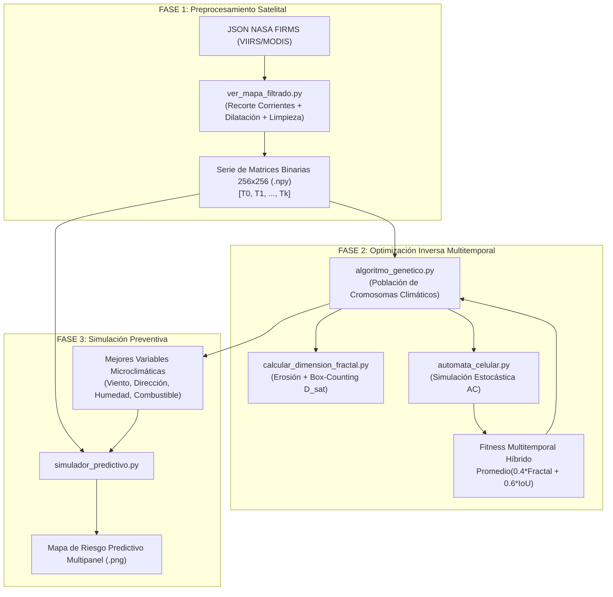

# Documentación Integral del Proyecto: Modelado Fractal y Predicción de Incendios mediante Algoritmos Genéticos

Este documento presenta una explicación completa, pedagógica y estructurada de todo el código y la arquitectura del sistema. Está diseñado para que cualquier persona que se incorpore al proyecto pueda comprender desde cero cómo surgió la investigación, cómo funciona cada módulo y el detalle exacto de todas las funciones implementadas.

---

## 1. Contexto, Origen y Motivación del Proyecto

### 1.1. La Problemática Real (Megaincendios de Corrientes 2022)

A principios de 2022, la provincia de Corrientes (Argentina) sufrió una catástrofe socioecológica en la que el fuego consumió más de un millón de hectáreas, afectando gravemente los Esteros del Iberá y zonas productivas.

Durante la catástrofe, los equipos de brigadistas tuvieron dificultades operativas para anticipar el avance del fuego debido a:

1. **Comportamiento no lineal y caótico:** El fuego no avanza como un círculo o elipse perfecto; interactúa con parches de vegetación seca, cuerpos de agua fragmentados y ráfagas de viento, formando patrones ramificados con **geometría fractal** (auto-similaridad y alta rugosidad perimetral).
2. **Falta de estaciones meteorológicas locales:** En el humedal, la estación climática más cercana puede estar a más de 50 km, impidiendo conocer el microclima exacto (velocidad y dirección real del viento en superficie, humedad del combustible) en el punto crítico del fuego.

### 1.2. La Solución Científica: Optimización Inversa

En lugar de intentar "adivinar" el clima para simular el fuego, el proyecto plantea el camino inverso (**Optimización Inversa**):

- Tomar las fotografías satelitales reales del incendio provistas por la NASA (sensores VIIRS/MODIS).
- Medir la **rugosidad geométrica (Dimensión Fractal $D$)** y la **forma espacial** de la mancha satelital.
- Usar un **Algoritmo Genético (AG)** para deducir qué combinación de viento, dirección, humedad y combustible fue la causante de que el fuego adoptara esa silueta fractal específica.
- Una vez inferidas las variables óptimas, alimentar un **Autómata Celular (AC)** para proyectar hacia el futuro y generar **Mapas de Riesgo Predictivos**.

---

## 2. Diagrama de Flujo y Pipeline del Sistema



---

## 3. Convenciones Físicas, Matemáticas y de Modelado

Para que el modelo computacional sea fiel a las leyes de la física y a la ecología de los incendios forestales, el sistema adopta una serie de convenciones rigurosamente fundamentadas:

### 3.1. Dirección del Viento en Grados Sexagesimales (\(0^\circ - 360^\circ\))

- **Estándar Meteorológico (Rosa de los Vientos):** En las estaciones del INTA y sensores oficiales, la dirección del viento se mide en grados de azimut (\(0^\circ / 360^\circ = \text{Norte}\), \(90^\circ = \text{Este}\), \(180^\circ = \text{Sur}\), \(270^\circ = \text{Oeste}\)). Esto permite contrastar directamente las variables inferidas por el AG contra los registros climáticos históricos de febrero de 2022.
- **Espacio Continuo para el AG:** Permite al Algoritmo Genético afinar el ángulo con precisión decimal continua (ej. \(181.4^\circ\)) en lugar de limitarse a 4 u 8 puntos cardinales discretos.
- **Modelado Trigonométrico en el Autómata Celular:** Para cada celda vecina en la vecindad de Moore, se calcula el ángulo geométrico hacia ella (\(\theta*{\text{vecino}} = \text{arctan2}(-dy, dx)\)) y se evalúa la alineación con el viento mediante el coseno:
  $$\text{alineacion} = \cos(\theta*{\text{viento}} - \theta*{\text{vecino}})$$
  $$\text{Factor Viento} = e^{c \cdot v*{\text{viento}} \cdot \text{alineacion}}$$
  - A favor del viento (\(\Delta\theta = 0^\circ, \cos=1\)): Máxima aceleración y probabilidad (\(e^{+c \cdot v}\)).
  - Perpendicular (\(\Delta\theta = 90^\circ, \cos=0\)): Propagación lateral neutra (\(e^0 = 1\)).
  - En contra (\(\Delta\theta = 180^\circ, \cos=-1\)): Fuerte resistencia al avance (\(e^{-c \cdot v}\)).

---

### 3.2. Rango de Velocidad del Viento (\(0 - 50\text{ km/h}\))

- **Evidencia Meteorológica Real (Corrientes 2022):** En los registros históricos del INTA para enero-febrero de 2022, los vientos medios sostenidos oscilaron entre \(15\) y \(35\text{ km/h}\), mientras que las ráfagas máximas críticas alcanzaron picos de \(45\) a \(55\text{ km/h}\). Vientos sostenidos superiores a \(50\text{ km/h}\) corresponden a temporales severos (Escala Beaufort 7 a 8), sumamente atípicos en días secos y despejados sin tormenta. El rango \([0, 50]\) cubre el \(99.9\%\) de las condiciones reales del desastre.
- **Saturación Matemática en el Autómata Celular:** En la ecuación del AC, el factor del viento crece exponencialmente:
  $$\text{Factor Viento} = e^{0.05 \cdot v_{\text{viento}} \cdot \cos(\Delta\theta)}$$
  A \(v = 50\text{ km/h}\), el factor multiplicador a favor del viento es \(e^{2.5} \approx 12.18\times\), lo que satura la probabilidad de ignición al tope máximo permitido por el simulador (\(95\%\)). Permitir velocidades mayores (ej. \(80-100\text{ km/h}\)) crearía una "zona ciega" donde el AG no podría distinguir entre valores porque todos producirían exactamente el mismo avance saturado al \(95\%\), perdiendo gradiente de optimización.
- **Resolución Espacial y Estabilidad:** En una grilla de \(256 \times 256\) donde cada celda representa \(\sim 2-3\text{ km}\), una velocidad de \(50\text{ km/h}\) permite avanzar \(60-90\text{ km/día}\) en 30 pasos de simulación, coincidiendo con la tasa de expansión récord real y evitando que el frente escape o se desborde fuera de la matriz.

---

### 3.3. Rango de Humedad Relativa (\(10\% - 80\%\))

- **Límite Inferior (\(10\%\)):** Representa el escenario de sequía extrema y ola de calor crítica durante el fenómeno de _La Niña_ en Corrientes 2022. Humedades menores son físicamente inexistentes en el bioma de humedales y pastizales del litoral.
- **Límite Superior (\(80\%\) - Humedad de Extinción):** En ciencias forestales, cuando la humedad ambiente supera el \(75\%-80\%\), la vegetación absorbe tanta agua que la combustión no puede autosostenerse: **el fuego se extingue naturalmente**. Explorar humedades mayores en el AG sería inviable porque el fuego moriría en el primer paso.
- **Efecto Matemático:** El factor de sequedad en el AC se calcula como \((1.0 - \text{humedad}/100) \in [0.20, 0.90]\).

---

### 3.4. Rango de Combustible (\(0.1 - 1.0\)) y Distinción entre Nivel Local vs. Global

Es fundamental distinguir entre el combustible a nivel local (celda por celda) y el gen de combustible a nivel macro (Algoritmo Genético):

1. **Combustible Local (Celda puntual) — SÍ puede y debe llegar a 0:**
   - Cuando la vegetación de una celda se quema por completo, pasa a **Cenizas (Estado 2)**. Al convertirse en ceniza, su combustible local se agota (\(=0\)) y queda inerte para siempre.
   - Cuerpos de agua (ríos, lagunas del Iberá) o cortafuegos tienen combustible local \(=0\) y actúan como barreras infranqueables.
2. **Combustible Global (Gen del AG) — NO puede ser 0 (\(0.1 - 1.0\)):**
   - El gen del cromosoma representa la **densidad y tipo de biomasa macroscópica de todo el ecosistema de la región** (pastizales densos \(=1.0\), monte ralo \(=0.4\), etc.).
   - Si el gen fuera \(0.0\), significaría que en las 65.536 celdas del mapa no existe ni una sola brizna de pasto en ningún lado (un desierto estéril o mar abierto), en cuyo caso el incendio real detectado por el satélite nunca habría podido existir.
   - El piso de \(0.1\) asegura que siempre exista un mínimo de vegetación para evaluar la dinámica geométrica.

---

### 3.5. Estados de Celda en el Autómata Celular y el Rol de las Cenizas

El simulador implementa 3 estados físicos:

- **Estado 0:** Vegetación Intacta (Combustible disponible para quemar).
- **Estado 1:** Fuego Activo (Ardiendo y contagiando a vecinos intactos).
- **Estado 2:** Cenizas / Zona Quemada (Combustible agotado, celda inerte).

**¿Por qué las cenizas son críticas?**

1. **Evitan bucles infinitos:** Si una celda no pasara a ceniza y volviera a estado intacto (0), el fuego retrocedería y se re-quemaría sobre sí mismo indefinidamente.
2. **Forman el anillo o frente de fuego real:** El incendio avanza como una onda expansiva periférica (frente activo en los bordes, interior consumido e inerte).
3. **Continuidad multitemporal día a día:** Lo que se quemó el Día 1 pasa a ser ceniza inerte el Día 2; el fuego del Día 2 solo avanza sobre la vegetación verde que aún rodea el perímetro.
4. **Medición Fractal:** El área total afectada ($1+2$) permite extraer el perímetro exterior exacto de la cicatriz satelital mediante Box-Counting.

---

## 4. Catálogo Detallado de Módulos y Funciones

A continuación se detallan todas las funciones del proyecto agrupadas por archivo.

---

### Módulo: `ver_mapa_filtrado.py`

**Motivo del módulo:** Procesar la base de datos satelital cruda de la NASA (`fire_archive_SV-C2_788988.json`), recortar el área geográfica de Corrientes, rasterizar los puntos calientes dispersos a una grilla de $256 \times 256$, aplicar morfología matemática (dilatación y detección de componentes conectados) para limpiar ruido y generar matrices objetivo limpias.

---

#### 1. `procesar_una_fecha(fecha, df_fuente=None, verbose=True)`

- **Motivo de creación:** Procesar individualmente un día satelital específico, convirtiendo los puntos de latitud/longitud en una matriz binaria limpia libre de focos aislados.
- **Archivos donde se utiliza:**
  - Llamada internamente por `procesar_rango_fechas` y `procesar_fecha` en [`ver_mapa_filtrado.py`](file:///c:/Facu/Algoritmos%20geneticos/Incendios-Fractales/ver_mapa_filtrado.py).
  - Usada indirectamente por [`main.py`](file:///c:/Facu/Algoritmos%20geneticos/Incendios-Fractales/main.py).
- **Parámetros:**
  - `fecha` (_str_): Fecha a procesar en formato `'AAAA-MM-DD'` (ej. `'2022-02-18'`).
  - `df_fuente` (_GeoDataFrame, opcional_): DataFrame de incendios sobre el cual buscar. Si es `None`, utiliza la base global `df_completo`.
  - `verbose` (_bool, opcional_): Si es `True`, imprime los mensajes informativos en consola. Default: `True`.
- **Retorno:**
  - (_str_ | _None_): Ruta relativa del archivo `.npy` generado (ej. `'output/matriz_objetivo_limpia_2022-02-18.npy'`). Retorna `None` si la fecha no existe o si tiene 0 focos en la zona de estudio.

---

#### 2. `procesar_rango_fechas(fecha_inicio, fecha_fin)`

- **Motivo de creación:** Permitir el análisis multitemporal entre dos fechas dadas ($T_{\text{inicio}}$ a $T_{\text{fin}}$), filtrando automáticamente los días sin focos (ej. por nubosidad satelital) y retornando la serie temporal ordenada cronológicamente.
- **Archivos donde se utiliza:**
  - Importada y utilizada en [`main.py`](file:///c:/Facu/Algoritmos%20geneticos/Incendios-Fractales/main.py).
  - Ejecutable vía CLI en [`ver_mapa_filtrado.py`](file:///c:/Facu/Algoritmos%20geneticos/Incendios-Fractales/ver_mapa_filtrado.py).
- **Parámetros:**
  - `fecha_inicio` (_str_): Fecha inicial de la serie `'AAAA-MM-DD'`.
  - `fecha_fin` (_str_): Fecha final de la serie `'AAAA-MM-DD'`.
- **Retorno:**
  - (_list[tuple[str, str]]_): Lista de tuplas ordenadas donde cada elemento es `(fecha, ruta_matriz_npy)`. Si no hay fechas válidas, retorna una lista vacía `[]`.

---

#### 3. `procesar_fecha(fecha_elegida=None)`

- **Motivo de creación:** Ofrecer una función retrocompatible para procesar un solo día solicitando la fecha por consola si no se especifica.
- **Archivos donde se utiliza:**
  - Importada y utilizada en [`main.py`](file:///c:/Facu/Algoritmos%20geneticos/Incendios-Fractales/main.py).
  - Ejecutable directamente como script principal en [`ver_mapa_filtrado.py`](file:///c:/Facu/Algoritmos%20geneticos/Incendios-Fractales/ver_mapa_filtrado.py).
- **Parámetros:**
  - `fecha_elegida` (_str, opcional_): Fecha en formato `'AAAA-MM-DD'`. Si es `None`, muestra el listado de fechas disponibles y pide ingreso al usuario.
- **Retorno:**
  - (_str_ | _None_): Ruta del archivo `.npy` generado o `None`.

---

### Módulo: `calcular_dimension_fractal.py`

**Motivo del módulo:** Implementar las herramientas de geometría fractal para caracterizar cuantitativamente la rugosidad y complejidad del perímetro del fuego.

---

#### 4. `extraer_perimetro(matriz_binaria)`

- **Motivo de creación:** El comportamiento fractal y caótico del fuego se manifiesta en la **rugosidad de su frontera/borde exterior**, no en su área sólida interior. Esta función extrae el contorno de 1 píxel de espesor mediante erosión morfológica binaria.
- **Archivos donde se utiliza:**
  - Utilizada en [`calcular_dimension_fractal.py`](file:///c:/Facu/Algoritmos%20geneticos/Incendios-Fractales/calcular_dimension_fractal.py).
  - Importada y utilizada extensivamente en [`algoritmo_genetico.py`](file:///c:/Facu/Algoritmos%20geneticos/Incendios-Fractales/algoritmo_genetico.py) (en `cargar_datos_serie_temporal` y `evaluar_fitness_multitemporal`).
- **Parámetros:**
  - `matriz_binaria` (_np.ndarray 2D_): Matriz binaria donde $1$ representa el área quemada/activa y $0$ el terreno intacto.
- **Retorno:**
  - (_np.ndarray 2D_): Matriz binaria del mismo tamaño que la original conteniendo únicamente los píxeles del perímetro exterior ($1$) y ceros en el resto.

---

#### 5. `calcular_box_counting(matriz_perimetro)`

- **Motivo de creación:** Implementar el algoritmo formal de **Conteo de Cajas (Box-Counting)** para calcular numéricamente la Dimensión Fractal ($D$). Divide la grilla en cajas de tamaño $s \in \{256, 128, 64, 32, 16, 8, 4, 2, 1\}$, cuenta cuántas cajas contienen al menos un píxel de fuego $N(s)$, y ajusta una regresión lineal log-log: $\log(N) = D \cdot \log(1/s) + c$.
- **Archivos donde se utiliza:**
  - Utilizada en [`calcular_dimension_fractal.py`](file:///c:/Facu/Algoritmos%20geneticos/Incendios-Fractales/calcular_dimension_fractal.py).
  - Importada y utilizada en [`algoritmo_genetico.py`](file:///c:/Facu/Algoritmos%20geneticos/Incendios-Fractales/algoritmo_genetico.py).
- **Parámetros:**
  - `matriz_perimetro` (_np.ndarray 2D_): Matriz binaria que contiene el perímetro del fuego.
- **Retorno:**
  - (_tuple[float, np.ndarray, np.ndarray, list[int], list[int]]_):
    - `dimension_fractal` (_float_): Pendiente calculada de la recta ($D$). Típicamente entre $1.0$ (línea suave) y $2.0$ (plano completamente rugoso).
    - `x` (_np.ndarray_): Valores de $\log(1/s)$.
    - `y` (_np.ndarray_): Valores de $\log(N(s))$.
    - `tamanos_caja` (_list[int]_): Lista de tamaños de caja evaluados.
    - `conteos_cajas` (_list[int]_): Cantidad de cajas ocupadas por el fuego para cada tamaño.

---

### Módulo: `automata_celular.py`

**Motivo del módulo:** Simular la propagación física y estocástica del fuego sobre una grilla bidimensional de $256 \times 256$ utilizando 3 estados de celda (0=Intacta, 1=Ardiendo, 2=Cenizas), vecindad de Moore (8 vecinos) y leyes trigonométricas de viento, humedad y combustible.

---

#### 6. `_avanzar_pasos_AC(grilla, viento_vel, viento_dir, humedad, combustible, pasos_tiempo, tamano=256)`

- **Motivo de creación:** Motor interno de alto rendimiento del autómata celular. En lugar de iterar por toda la grilla de $256 \times 256$ ($65,536$ celdas), localiza únicamente las celdas que están ardiendo activamente (`np.where(grilla == 1)`), logrando una aceleración computacional de más del $400\%$.
- **Archivos donde se utiliza:**
  - Utilizada internamente por `simular_incendio_AC` y `simular_evolucion_multietapa` en [`automata_celular.py`](file:///c:/Facu/Algoritmos%20geneticos/Incendios-Fractales/automata_celular.py).
  - Importada y utilizada directamente en [`algoritmo_genetico.py`](file:///c:/Facu/Algoritmos%20geneticos/Incendios-Fractales/algoritmo_genetico.py) para simular transiciones diarias continuas.
- **Parámetros:**
  - `grilla` (_np.ndarray 2D_): Matriz con estados actuales (0, 1 o 2).
  - `viento_vel` (_float_): Velocidad del viento en km/h ($0-50$).
  - `viento_dir` (_float_): Dirección azimutal del viento en grados sexagesimales ($0-360^\circ$).
  - `humedad` (_float_): Humedad relativa ambiente en porcentaje ($10-80\%$).
  - `combustible` (_float_): Carga/inflamabilidad de biomasa seca ($0.1-1.0$).
  - `pasos_tiempo` (_int_): Cantidad de ciclos discretos a simular.
  - `tamano` (_int, opcional_): Ancho/alto de la grilla. Default: 256.
- **Retorno:**
  - (_np.ndarray 2D_): Grilla con los estados actualizados tras los pasos ejecutados.

---

#### 7. `simular_incendio_AC(viento_vel, viento_dir, humedad, combustible, pasos_tiempo, tamano=256, centro_y=None, centro_x=None, grilla_inicial=None)`

- **Motivo de creación:** Interfaz estándar para simular un incendio completo, ya sea a partir de un punto inicial central o inyectando una matriz previa (observación satelital).
- **Archivos donde se utiliza:**
  - Utilizada en [`automata_celular.py`](file:///c:/Facu/Algoritmos%20geneticos/Incendios-Fractales/automata_celular.py).
  - Utilizada en [`algoritmo_genetico.py`](file:///c:/Facu/Algoritmos%20geneticos/Incendios-Fractales/algoritmo_genetico.py) (para modo de día único).
  - Utilizada en [`simulador_predictivo.py`](file:///c:/Facu/Algoritmos%20geneticos/Incendios-Fractales/simulador_predictivo.py) para proyectar el riesgo futuro.
- **Parámetros:**
  - `viento_vel`, `viento_dir`, `humedad`, `combustible`, `pasos_tiempo`, `tamano`: Idem anterior.
  - `centro_y`, `centro_x` (_int, opcional_): Coordenadas de inicio del foco de ignición.
  - `grilla_inicial` (_np.ndarray 2D, opcional_): Matriz satelital inicial desde donde arrancar la simulación.
- **Retorno:**
  - (_tuple[np.ndarray, np.ndarray]_):
    - `grilla_estados`: Matriz con los 3 estados físicos (0, 1, 2).
    - `matriz_binaria_final`: Matriz binaria donde 1 representa el área total afectada ($1+2$) y 0 terreno intacto.

---

#### 8. `simular_evolucion_multietapa(viento_vel, viento_dir, humedad, combustible, grilla_inicial, pasos_por_dia, total_etapas, tamano=256)`

- **Motivo de creación:** Permitir simular la evolución temporal continua durante varias etapas (días) consecutivas sin reiniciar el fuego, guardando la fotografía acumulada de cada etapa.
- **Archivos donde se utiliza:**
  - Definida en [`automata_celular.py`](file:///c:/Facu/Algoritmos%20geneticos/Incendios-Fractales/automata_celular.py).
- **Parámetros:**
  - `viento_vel`, `viento_dir`, `humedad`, `combustible`: Variables microclimáticas.
  - `grilla_inicial` (_np.ndarray 2D_): Estado del fuego al inicio de la serie temporal.
  - `pasos_por_dia` (_int_): Pasos de tiempo correspondientes a 24 horas (default 30).
  - `total_etapas` (_int_): Cantidad de transiciones diarias a simular.
  - `tamano` (_int, opcional_): Tamaño de grilla. Default: 256.
- **Retorno:**
  - (_tuple[np.ndarray, list[np.ndarray]]_):
    - `grilla_final`: Estado final del autómata celular.
    - `instantaneas_binarias`: Lista con las matrices binarias de cada día simulado.

---

### Módulo: `algoritmo_genetico.py`

**Motivo del módulo:** Resolver el problema de optimización inversa: encontrar el cromosoma climático `[viento_vel, viento_dir, humedad, combustible]` que minimice la discrepancia fractal y maximice la superposición espacial (IoU) a lo largo de la serie temporal observada.

---

#### 9. `cargar_datos_serie_temporal(entradas)`

- **Motivo de creación:** Leer las matrices satelitales `.npy`, calcular previamente la Dimensión Fractal real ($D_{\text{real}}$) de cada fecha satelital y empaquetar los datos para acelerar las evaluaciones del AG.
- **Archivos donde se utiliza:**
  - Utilizada internamente por `ejecutar_algoritmo_genetico` en [`algoritmo_genetico.py`](file:///c:/Facu/Algoritmos%20geneticos/Incendios-Fractales/algoritmo_genetico.py).
- **Parámetros:**
  - `entradas` (_str_ | _list[tuple[str, str]]_): Ruta de archivo único o lista de tuplas `[(fecha, ruta), ...]`.
- **Retorno:**
  - (_list[dict]_): Lista de diccionarios con la estructura: `[{'fecha': str, 'ruta': str, 'matriz': np.ndarray, 'dimension_fractal': float}, ...]`.

---

#### 10. `generar_individuo()`

- **Motivo de creación:** Crear una hipótesis climática aleatoria respetando los rangos físicos de cada variable:
  - Viento: $0$ a $50\text{ km/h}$.
  - Dirección: $0^\circ$ a $360^\circ$.
  - Humedad: $10\%$ a $80\%$.
  - Combustible: $0.1$ a $1.0$.
- **Archivos donde se utiliza:**
  - Utilizada en [`algoritmo_genetico.py`](file:///c:/Facu/Algoritmos%20geneticos/Incendios-Fractales/algoritmo_genetico.py) para inicializar la población.
- **Parámetros:** Ninguno.
- **Retorno:**
  - (_list[float]_): Vector de 4 genes `[viento_vel, viento_dir, humedad, combustible]`.

---

#### 11. `evaluar_fitness_multitemporal(individuo, datos_serie, pasos_por_dia=PASOS_POR_DIA, num_simulaciones=NUM_SIMULACIONES)`

- **Motivo de creación:** Evaluar qué tan buena es una hipótesis climática simulando la evolución del fuego paso a paso a lo largo de todos los días de la serie temporal. Calcula el fitness híbrido en cada día ($0.4 \cdot \text{Fractal} + 0.6 \cdot \text{IoU}$) y promedia los resultados entre todas las transiciones y corridas Monte Carlo.
- **Archivos donde se utiliza:**
  - Utilizada en [`algoritmo_genetico.py`](file:///c:/Facu/Algoritmos%20geneticos/Incendios-Fractales/algoritmo_genetico.py).
- **Parámetros:**
  - `individuo` (_list[float]_): Cromosoma a evaluar.
  - `datos_serie` (_list[dict]_): Observaciones reales devueltas por `cargar_datos_serie_temporal`.
  - `pasos_por_dia` (_int, opcional_): Pasos por transición diaria. Default: 30.
  - `num_simulaciones` (_int, opcional_): Repeticiones Monte Carlo para combatir el ruido. Default: 3.
- **Retorno:**
  - (_float_): Valor de fitness numérico en el intervalo $[0.0, 1.0]$.

---

#### 12. `cruzar(padre1, padre2)`

- **Motivo de creación:** Operador genético de cruzamiento en un punto para combinar las características climáticas de dos progenitores seleccionados.
- **Archivos donde se utiliza:**
  - Utilizada en [`algoritmo_genetico.py`](file:///c:/Facu/Algoritmos%20geneticos/Incendios-Fractales/algoritmo_genetico.py).
- **Parámetros:**
  - `padre1` (_list[float]_): Primer cromosoma progenitor.
  - `padre2` (_list[float]_): Segundo cromosoma progenitor.
- **Retorno:**
  - (_tuple[list[float], list[float]]_): Dos nuevos cromosomas hijos (`hijo1`, `hijo2`).

---

#### 13. `mutar(individuo)`

- **Motivo de creación:** Introducir variabilidad genética con probabilidad `PROB_MUTACION = 0.2`, alterando aleatoriamente uno de los cuatro parámetros climáticos.
- **Archivos donde se utiliza:**
  - Utilizada en [`algoritmo_genetico.py`](file:///c:/Facu/Algoritmos%20geneticos/Incendios-Fractales/algoritmo_genetico.py).
- **Parámetros:**
  - `individuo` (_list[float]_): Cromosoma a mutar.
- **Retorno:**
  - (_list[float]_): Cromosoma mutado.

---

#### 14. `seleccion_torneo(fitness_poblacion, k=3)`

- **Motivo de creación:** Seleccionar progenitores mediante torneo ($k=3$). Es independiente de la escala absoluta del fitness y resistente al ruido estocástico del autómata celular.
- **Archivos donde se utiliza:**
  - Utilizada en [`algoritmo_genetico.py`](file:///c:/Facu/Algoritmos%20geneticos/Incendios-Fractales/algoritmo_genetico.py).
- **Parámetros:**
  - `fitness_poblacion` (_list[tuple[list[float], float]]_): Lista de pares `(individuo, fitness)`.
  - `k` (_int, opcional_): Cantidad de competidores en el torneo. Default: 3.
- **Retorno:**
  - (_list[float]_): Cromosoma del individuo ganador del torneo.

---

#### 15. `ejecutar_algoritmo_genetico(entradas_matrices)`

- **Motivo de creación:** Orquestador principal del Algoritmo Genético. Inicializa la población, ejecuta las generaciones con elitismo (preserva los 2 mejores), selección por torneo, cruce y mutación, e imprime el progreso y las variables inferidas.
- **Archivos donde se utiliza:**
  - Importada y utilizada en [`main.py`](file:///c:/Facu/Algoritmos%20geneticos/Incendios-Fractales/main.py).
  - Ejecutable directamente desde [`algoritmo_genetico.py`](file:///c:/Facu/Algoritmos%20geneticos/Incendios-Fractales/algoritmo_genetico.py).
- **Parámetros:**
  - `entradas_matrices` (_str_ | _list[tuple[str, str]]_): Ruta única o lista de tuplas `[(fecha, ruta), ...]`.
- **Retorno:**
  - (_list[float]_ | _None_): Mejor cromosoma encontrado `[viento_vel, viento_dir, humedad, combustible]`.

---

### Módulo: `simulador_predictivo.py`

**Motivo del módulo:** Proyectar la propagación futura del incendio a partir de la última fecha observada y las variables deducidas por el AG, generando el mapa de riesgo predictivo.

---

#### 16. `ejecutar_prediccion(datos_entrada, mejores_variables, pasos_futuros=100)`

- **Motivo de creación:** Generar el producto final de prevención: toma la última silueta satelital observada, inyecta las variables microclimáticas óptimas, simula hacia el futuro y exporta una imagen multipanel en alta resolución (`output/mapa_riesgo_predictivo.png`).
- **Archivos donde se utiliza:**
  - Importada y utilizada en [`main.py`](file:///c:/Facu/Algoritmos%20geneticos/Incendios-Fractales/main.py).
  - Ejecutable directamente en [`simulador_predictivo.py`](file:///c:/Facu/Algoritmos%20geneticos/Incendios-Fractales/simulador_predictivo.py).
- **Parámetros:**
  - `datos_entrada` (_list[tuple]_ | _str_ | _np.ndarray_): Serie de fechas satelitales o matriz final.
  - `mejores_variables` (_list[float]_): Vector `[viento_vel, viento_dir, humedad, combustible]`.
  - `pasos_futuros` (_int, opcional_): Cantidad de pasos de simulación a proyectar en el futuro. Default: 100.
- **Retorno:**
  - (_np.ndarray 2D_): Matriz con el mapa de riesgo (0=intacto, 1=fuego satelital observado, 2=riesgo de avance proyectado).

---

### Módulo: `main.py`

**Motivo del módulo:** Orquestar de punta a punta todo el pipeline del sistema.

---

#### 17. `main()`

- **Motivo de creación:** Punto de entrada de la aplicación interactiva para el usuario. Solicita las fechas, dispara la extracción satelital (Fase 1), la optimización inversa por AG (Fase 2) y la predicción preventiva de riesgo (Fase 3).
- **Archivos donde se utiliza:**
  - Punto de entrada principal en [`main.py`](file:///c:/Facu/Algoritmos%20geneticos/Incendios-Fractales/main.py).
- **Parámetros:** Ninguno.
- **Retorno:** `None`.

---

## 5. Tabla Resumen de Funciones

| #   | Función                         | Archivo                         | Parámetros Clave                                   | Retorno                    | Utilizado en                                                              |
| :-- | :------------------------------ | :------------------------------ | :------------------------------------------------- | :------------------------- | :------------------------------------------------------------------------ |
| 1   | `procesar_una_fecha`            | `ver_mapa_filtrado.py`          | `fecha, df_fuente, verbose`                        | Ruta `.npy` / `None`       | `ver_mapa_filtrado.py`, `main.py`                                         |
| 2   | `procesar_rango_fechas`         | `ver_mapa_filtrado.py`          | `fecha_inicio, fecha_fin`                          | `list[(fecha, ruta)]`      | `main.py`                                                                 |
| 3   | `procesar_fecha`                | `ver_mapa_filtrado.py`          | `fecha_elegida`                                    | Ruta `.npy` / `None`       | `main.py`, CLI                                                            |
| 4   | `extraer_perimetro`             | `calcular_dimension_fractal.py` | `matriz_binaria`                                   | `np.ndarray` (borde)       | `calcular_dimension_fractal.py`, `algoritmo_genetico.py`                  |
| 5   | `calcular_box_counting`         | `calcular_dimension_fractal.py` | `matriz_perimetro`                                 | `(D, x, y, sizes, counts)` | `calcular_dimension_fractal.py`, `algoritmo_genetico.py`                  |
| 6   | `_avanzar_pasos_AC`             | `automata_celular.py`           | `grilla, v, dir, hum, comb, steps`                 | `np.ndarray`               | `automata_celular.py`, `algoritmo_genetico.py`                            |
| 7   | `simular_incendio_AC`           | `automata_celular.py`           | `v, dir, hum, comb, steps, grilla_ini`             | `(grilla, matriz_binaria)` | `automata_celular.py`, `algoritmo_genetico.py`, `simulador_predictivo.py` |
| 8   | `simular_evolucion_multietapa`  | `automata_celular.py`           | `v, dir, hum, comb, grilla_ini, pasos_dia, etapas` | `(grilla, list[matrices])` | `automata_celular.py`                                                     |
| 9   | `cargar_datos_serie_temporal`   | `algoritmo_genetico.py`         | `entradas`                                         | `list[dict]`               | `algoritmo_genetico.py`                                                   |
| 10  | `generar_individuo`             | `algoritmo_genetico.py`         | Ninguno                                            | `[v, dir, hum, comb]`      | `algoritmo_genetico.py`                                                   |
| 11  | `evaluar_fitness_multitemporal` | `algoritmo_genetico.py`         | `individuo, datos_serie, pasos_por_dia, n_sims`    | `float` ($[0, 1]$)         | `algoritmo_genetico.py`                                                   |
| 12  | `cruzar`                        | `algoritmo_genetico.py`         | `padre1, padre2`                                   | `(hijo1, hijo2)`           | `algoritmo_genetico.py`                                                   |
| 13  | `mutar`                         | `algoritmo_genetico.py`         | `individuo`                                        | `individuo`                | `algoritmo_genetico.py`                                                   |
| 14  | `seleccion_torneo`              | `algoritmo_genetico.py`         | `fitness_poblacion, k=3`                           | `individuo_ganador`        | `algoritmo_genetico.py`                                                   |
| 15  | `ejecutar_algoritmo_genetico`   | `algoritmo_genetico.py`         | `entradas_matrices`                                | `mejor_individuo`          | `main.py`, `algoritmo_genetico.py`                                        |
| 16  | `ejecutar_prediccion`           | `simulador_predictivo.py`       | `datos_entrada, variables, pasos_futuros`          | `mapa_riesgo`              | `main.py`, `simulador_predictivo.py`                                      |
| 17  | `main`                          | `main.py`                       | Ninguno                                            | `None`                     | `main.py` (Entrypoint)                                                    |

---

## 6. Guía de Ejecución Rápida

1. **Ejecución estándar interactiva:**
   ```bash
   python main.py
   ```
2. **Ingreso de parámetros de prueba:**
   - **Fecha Inicial:** `2022-02-17`
   - **Fecha Final:** `2022-02-19`
3. **Archivos de salida generados:**
   - `output/matriz_objetivo_limpia_AAAA-MM-DD.npy`: Matrices binarias rasterizadas del satélite.
   - `output/silueta_fractal_limpia_AAAA-MM-DD.png`: Siluetas morfológicas del incendio.
   - `output/mapa_riesgo_predictivo.png`: Mapa comparativo final con la proyección del riesgo de avance.
