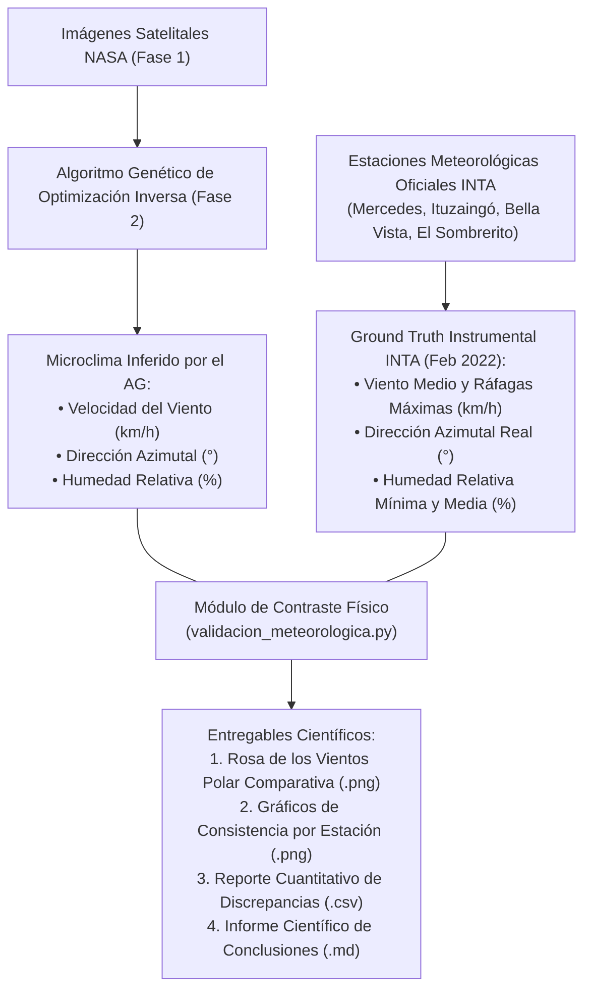

# Plan de Implementación: T3.3 — Comparación con Estaciones Meteorológicas del INTA (*Ground Truth Climático*)

**Estado:** Documento de Diseño Técnico y Metodológico (Pendiente de Ejecución)  
**Módulos Afectados:** `validacion_meteorologica.py`, `main.py`, `docs/tasks.md`, `data/meteorologia_inta_corrientes_febrero_2022.csv`  
**Tarea Asociada en Hoja de Ruta (`tasks.md`):** **T3.3** (*Validación contra Ground Truth Meteorológico del INTA*)

---

## 1. Motivación y Justificación Científica

El Algoritmo Genético de Optimización Inversa (Fase 2) deduce los parámetros microclimáticos latentes ($v_{\text{viento}}, \theta_{\text{dir}}, H_{\text{hum}}$) **exclusivamente a partir de la morfología fractal y expansión espacial de las cicatrices de calor detectadas por satélites de la NASA**.

Para demostrar científicamente ante revisores pares que estas variables deducidas no son meros "ajustes matemáticos artificiales" sino que reflejan **la física real de la atmósfera durante el megaincendio de Corrientes (febrero 2022)**, este módulo contrasta las variables inferidas contra los registros de la **red agrometeorológica oficial del INTA (Instituto Nacional de Tecnología Agropecuaria)**.

---

## 2. Consideraciones Físicas y Matemáticas

1. **Tratamiento Angular Circular de la Dirección del Viento:**
   Al comparar direcciones azimutales ($0^\circ - 360^\circ$), se implementará la **distancia geodésica circular** para evitar distorsiones en el cruce por el Norte ($0^\circ / 360^\circ$):
   $$\Delta\theta = \min(|\theta_{\text{AG}} - \theta_{\text{INTA}}|, \ 360^\circ - |\theta_{\text{AG}} - \theta_{\text{INTA}}|)$$

2. **Intervalo Físico de Velocidad y Humedad:**
   - Se validará si la velocidad inferida por el AG cae dentro del intervalo físicamente activo de propagación: $[v_{\text{medio\_sostenido}}, v_{\text{ráfaga\_máxima}}]$.
   - La humedad del AG se contrastará principalmente contra la **humedad mínima diurna** registrada en las horas de máxima insolación y temperatura (13:00 - 16:00 hs), período donde se produce la expansión crítica del fuego.

---

## 3. Propuesta Técnica Detallada

### 1. Dataset de Ground Truth Instrumental
#### `data/meteorologia_inta_corrientes_febrero_2022.csv`
Compilación estructurada de los registros climáticos del INTA para las estaciones representativas de la provincia de Corrientes durante los días del evento (15 al 22 de febrero de 2022):
* **Estaciones:**
  1. *INTA Mercedes* (Lat -29.19°, Lon -58.07°) — Cuenca central y humedales del sur (zona de mayor superficie quemada).
  2. *INTA Ituzaingó* (Lat -27.58°, Lon -56.68°) — Margen norte / Esteros del Iberá.
  3. *INTA Bella Vista* (Lat -28.51°, Lon -59.04°) — Costa occidental del río Paraná.
  4. *INTA Corrientes (El Sombrerito)* (Lat -27.66°, Lon -58.76°).
* **Campos:** `fecha`, `estacion`, `latitud`, `longitud`, `viento_medio_kmh`, `viento_rafaga_max_kmh`, `viento_direccion_grados`, `humedad_relativa_min_pct`, `humedad_relativa_media_pct`, `temperatura_max_c`.

---

### 2. Módulo de Validación y Análisis Estadístico
#### `validacion_meteorologica.py`
Script con backend `matplotlib.use('Agg')` que:
1. Recibe las fechas analizadas y las variables microclimáticas deducidas por el AG (o las lee de `output/resultados_optimizacion.csv` o las calibra si se ejecuta de forma independiente).
2. Extrae las lecturas correspondientes de las 4 estaciones del INTA para esas mismas fechas.
3. Evalúa la consistencia física:
   * **Error Angular Circular ($\Delta\theta$):** Grados de desvío frente a cada estación y al promedio vectorial provincial.
   * **Error Absoluto de Velocidad ($|v_{\text{AG}} - v_{\text{INTA}}|$):** Verificación de pertenencia al rango $[v_{\text{medio}}, v_{\text{ráfagas}}]$.
   * **Error de Humedad Relativa ($|H_{\text{AG}} - H_{\text{INTA}}|$):** Contraste frente a la humedad mínima diurna.
4. Genera los entregables:
   * **`output/validacion_meteorologica_rosa_vientos.png`:** Gráfico polar (Rosa de los Vientos) superponiendo el vector inferido por el AG vs. las direcciones registradas por las estaciones del INTA.
   * **`output/validacion_meteorologica_comparativa.png`:** Gráfico de barras agrupadas comparativo.
   * **`output/reporte_validacion_meteorologica.csv`:** Tabla cuantitativa de discrepancias y métricas estadísticas.

---

### 3. Integración en `main.py` como Fase 5

* Añadir la invocación de `ejecutar_validacion_meteorologica` tras la Fase 4 de Walk-Forward, completando la suite integral de 5 fases:
  1. *Fase 1:* Extracción y rasterización satelital.
  2. *Fase 2:* Optimización inversa (AG).
  3. *Fase 3:* Predicción y cartografía GIS multi-horizonte.
  4. *Fase 4:* Validación fuera de muestra (Walk-Forward +24h, +48h, +72h).
  5. *Fase 5:* Validación meteorológica con estaciones del INTA.

---

### 4. Documentación Modular según `estrucura_documentacion.md`

* **`docs/files/validacion_meteorologica/validacion_meteorologica.md`:** Documento de descripción y justificación arquitectónica.
* **`docs/files/validacion_meteorologica/functions.md`:** Catálogo de funciones y tabla de trazabilidad de referencias cruzadas.
* **`docs/conclusion_validacion_meteorologica.md`:** Informe científico formal con el análisis biofísico.
* **`docs/tasks.md`:** Actualizar **T3.3** a `[x] Implementado`.
