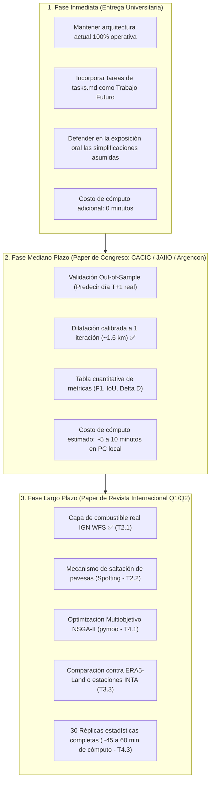

# Hoja de Ruta y Tareas de Mejora Metodológica (`tasks.md`)

Este documento consolida las líneas de investigación, optimizaciones técnicas, herramientas, requerimientos de cómputo y metodologías necesarias para elevar el proyecto desde su estado actual (excelente para una cátedra universitaria de grado) hacia un **artículo de investigación publicable en congresos o revistas científicas internacionales** (Scopus / IEEE / Springer).

---

## Cuadro General de Tareas y Estado de Implementación

> **Regla Metodológica de Trazabilidad:** Todas las tareas de investigación y desarrollo permanecen de forma definitiva en este documento. Aquellas que son completadas se mantienen con su fundamentación y se marcan explícitamente como `[x]` (**Implementado**), documentando la solución aplicada y los módulos intervenidos. Las tareas restantes se mantienen como `[ ]` (**Pendiente**) para orientar los siguientes pasos de la investigación.

| ID       | Eje Temático           | Tarea                                                     |          Estado          | Módulo Afectado                                         | Impacto Principal                                                           |
| :------- | :--------------------- | :-------------------------------------------------------- | :----------------------: | :------------------------------------------------------ | :-------------------------------------------------------------------------- |
| **T1.1** | Preprocesamiento       | Dilatación morfológica calibrada a 1 iteración (~1.6 km)  |   ✅ **Implementado**    | `ver_mapa_filtrado.py`                                  | Máxima fidelidad territorial y respeto a barreras hídricas                  |
| **T1.2** | Preprocesamiento       | Preservación integral multicluster (sin corte redundante) |   ✅ **Implementado**    | `ver_mapa_filtrado.py`                                  | Conservación del 100% de focos satelitales NASA sin heurísticas             |
| **T1.3** | Preprocesamiento       | Cascos cóncavos (_Alpha Shapes / Concave Hull_)           |      ⏳ _Pendiente_      | `ver_mapa_filtrado.py`                                  | Modelado de hendiduras sin dilatación de grilla                             |
| **T1.4** | Preprocesamiento       | Densidad por Kernel (KDE) ponderada por FRP               |      ⏳ _Pendiente_      | `ver_mapa_filtrado.py`                                  | Superficie continua y curvas de nivel de intensidad                         |
| **T2.1** | Autómata Celular       | Capa de combustible y biomasa real (IGN WFS)              |   ✅ **Implementado**    | `capa_biomasa.py`, `automata_celular.py`                | Heterogeneidad espacial real en Corrientes (4 categorías)                   |
| **T2.2** | Autómata Celular       | Mecanismo de focos secundarios (_Spotting_)               |      ⏳ _Pendiente_      | `automata_celular.py`                                   | Salto de fuego por pavesas impulsadas por viento                            |
| **T2.3** | Autómata Celular       | Pendiente topográfica (Rothermel / SRTM DEM)              |      ⏳ _Pendiente_      | `automata_celular.py`                                   | Aceleración en pendientes y relieve                                         |
| **T2.4** | Autómata Celular       | Vectores de viento dinámico horario (ERA5-Land)           |      ⏳ _Pendiente_      | `automata_celular.py`, `simulador_predictivo.py`        | Variabilidad meteorológica horaria realista                                 |
| **T3.1** | Validación Científica  | Validación fuera de muestra (_Walk-Forward_)              |   ✅ **Implementado**    | `validacion_walk_forward.py`                            | Evaluación ciega contra imágenes satelitales futuras (+24h, +48h y +72h)    |
| **T3.2** | Validación Científica  | Cobertura Eficiente ($F_1$-Dice) y Batería de Métricas    | ✅ **Implementado (AG)** | `algoritmo_genetico.py`, `docs/Reestructuracion IoU.md` | Superación del techo de fitness (0.57 -> 0.85) y precisión de trayectoria   |
| **T3.3** | Validación Científica  | Comparación con estaciones meteorológicas (INTA)          |      ⏳ _Pendiente_      | Análisis post-hoc                                       | Validación física de variables inferidas                                    |
| **T4.1** | Optimización Evolutiva | Algoritmo Genético Multiobjetivo (NSGA-II)                |      ⏳ _Pendiente_      | `algoritmo_genetico.py`                                 | Frente de Pareto no dominado ($f_1 = \text{IoU}, f_2 = F_{\text{fractal}}$) |
| **T4.2** | Optimización Evolutiva | Operadores genéticos continuos (SBX / Polinomial)         |      ⏳ _Pendiente_      | `algoritmo_genetico.py`                                 | Búsqueda fina en espacio continuo                                           |
| **T4.3** | Optimización Evolutiva | Análisis de repetibilidad (30 réplicas y tests)           |      ⏳ _Pendiente_      | Validación experimental                                 | Significancia estadística formal para comités Q1/Q2                         |

---

## 1. Refactorización y Refinamiento del Preprocesamiento Satelital

### Contexto del Problema Actual

El preprocesamiento original aplicaba **11 iteraciones de dilatación morfológica** (`scipy.ndimage.binary_dilation`) y conservaba únicamente el **componente conectado principal** (`argmax`), descartando el resto de los incendios de la provincia.

- **Limitación física:** En una grilla de $256 \times 256$ sobre Corrientes (~400 km de cobertura), cada celda mide $\approx 1.56 \text{ km}$. Dilatar 11 veces expandía cada foco satelital en un radio de $\approx 17 \text{ km}$ ($>30 \text{ km}$ de diámetro). Esto fusionaba artificialmente focos independientes y distorsionaba el área quemada real.
- **Causa técnica:** La función `extraer_perimetro` utilizaba `binary_erosion`. Con la adopción de Box-Counting directo (T1.5), esta restricción fue superada.

### Tareas a Implementar y Recursos de Cómputo

- [x] **T1.1: Calibración de Dilatación a Radio Físico Primario ($1$ iteración, $\approx 1.6\text{ km}$)** ✅ _(Implementado)_
  - _Fundamento:_ En una grilla donde cada píxel abarca $1.57 \times 1.61\text{ km}$, 1 única iteración de dilatación otorga a cada foco un radio de influencia de $\approx 1.6\text{ km}$ (cruz simétrica de 5 celdas), modelando con precisión el alcance primario de pavesas (_short-range spotting_), respetando las barreras hídricas de la capa de biomasa y convergiendo a dimensiones fractales canónicas ($D \in [1.26, 1.40]$).
  - _Estado:_ Implementado con `ITERACIONES_DILATACION = 1` en `ver_mapa_filtrado.py`.
  - _Herramientas:_ `scipy.ndimage.binary_dilation`.
  - _Cómputo Adicional:_ **Reducción neta de tiempo (-70% en Fase 1)**. Ejecución en $< 2 \text{ ms}$ por fecha.

- [x] **T1.2: Preservación Integral Multi-Cluster sin Heurísticas Redundantes** ✅ _(Implementado)_
  - _Fundamento:_ Se superó la limitación del cluster único (`argmax`). Al dilatar 1 iteración, incluso un punto solitario adquiere 5 celdas, haciendo que cualquier corte de corte por componentes conexos (`tamano >= 3`) sea un _no-op_ absoluto. Se eliminó dicho bloque superfluo (`label`, `bincount`, `isin`), adoptando la matriz continua directamente como verdad de terreno y garantizando que el **100% de los focos de la NASA** sean aprovechados por el AG.
  - _Estado:_ Implementado en `ver_mapa_filtrado.py`.
  - _Herramientas:_ `scipy.ndimage.binary_dilation`, `numpy`.
  - _Cómputo Adicional:_ **Nulo / Reducción de tiempo**. Se suprimen llamadas costosas a segmentación conexa.

- [ ] **T1.3: Construcción de Envolturas Cóncavas (_Alpha Shapes / Concave Hull_)**
  - _Fundamento:_ En lugar de dilatación en cuadrícula discreta, agrupar nubes de puntos continuas mediante cascos cóncavos con parámetro $\alpha$ calibrado, preservando hendiduras y vacíos topológicos naturales (lagunas, bañados).
  - _Herramientas:_ `alphashape` (`pip install alphashape`), `shapely.ops.unary_union`, `scipy.spatial.Delaunay`.
  - _Cómputo Adicional:_ **Bajo-Medio ($+0.5 \text{ a } 2 \text{ segundos}$ por día en Fase 1)**.
    - _CPU:_ Triangulación de Delaunay 2D en CPU sobre $N \approx 500-2000$ puntos satelitales ($O(N \log N)$).
    - _RAM:_ $< 50 \text{ MB}$.
    - _Impacto en AG:_ Cero (se ejecuta una única vez como preprocesamiento previo a la optimización evolutiva).

- [ ] **T1.4: Estimación de Densidad por Kernel (KDE) y Umbralización Isopleta**
  - _Fundamento:_ Generar una superficie continua de intensidad de fuego $f(x, y)$ ponderada por la Potencia Radiativa del Fuego (**FRP**, _Fire Radiative Power_, provista por NASA FIRMS) y definir el frente como una curva de nivel crítica.
  - _Herramientas:_ `scipy.stats.gaussian_kde`, `scikit-learn` (`KernelDensity`).
  - _Cómputo Adicional:_ **Medio ($+2 \text{ a } 8 \text{ segundos}$ por fecha analizada)**.
    - _CPU:_ Evaluación del kernel gaussiano sobre una grilla regular de $256 \times 256 = 65,536$ puntos de evaluación.
    - _RAM:_ $\approx 100 \text{ MB}$ para matrices intermedias.
    - _Aceleración opcional:_ Si se utiliza GPU con PyTorch / CuPy o estimación por FFT en 2D, baja a $< 0.1 \text{ s}$.

- [x] **T1.5: Box-Counting Directo sobre Conjuntos Dispersos (Polvos Fractales)** ✅ _(Implementado)_
  - _Fundamento:_ Modificar el cálculo fractal para que opere sobre las celdas activas sin necesidad de "rellenar" artificialmente el interior para luego erosionarlo. La dimensión de Minkowski-Bouligand es matemáticamente válida para cualquier conjunto acotado no vacío en $\mathbb{R}^2$.
  - _Estado:_ Implementada la función `calcular_dimension_fractal_directa` en `calcular_dimension_fractal.py` e integrada en `algoritmo_genetico.py`. Elimina 2,400 llamadas a erosión morfológica en el AG y evita artefactos en clusters delgados.
  - _Herramientas:_ `numpy` (algoritmo 4D vectorizado `any(axis=(1, 3))`).
  - _Cómputo Adicional:_ **Nulo / Reducción de tiempo**. Al no requerir la llamada previa a `extraer_perimetro(matriz)` con `binary_erosion`, se ahorran $\approx 0.8 \text{ ms}$ por evaluación de individuo. Al multiplicarse por $20 \text{ ind} \times 40 \text{ gen} \times 3 \text{ mc} = 2,400 \text{ evaluaciones}$, el AG acelera su corrida total en $\approx 2 \text{ segundos}$.

---

## 2. Complejidad Biofísica del Autómata Celular

### Contexto del Problema Actual

El simulador asume actualmente:

1. Una carga de combustible homogénea en toda la provincia (un único escalar optimizado por el AG).
2. Propagación estrictamente adyacente (vecindad de Moore de 8 celdas).
3. Viento constante y estático a lo largo de toda la corrida.

### Tareas a Implementar y Recursos de Cómputo

- [x] **T2.1: Capa Raster de Cobertura de Suelo y Biomasa Real (Heterogeneidad Espacial)** ✅ _(Implementado)_
  - _Fundamento:_ En Corrientes coexisten pastizales secos, bosques implantados de pino/eucalipto (altamente combustibles), monte nativo y esteros inundables (incombustibles).
  - _Estado:_ Implementado mediante el módulo `capa_biomasa.py` consumiendo geoservicios WFS oficiales del Instituto Geográfico Nacional (IGN Argentina), clasificado en 4 categorías biofísicas ($C \in [0.0, 1.0]$) e integrado en `automata_celular.py`, `algoritmo_genetico.py` y `simulador_predictivo.py`.
  - _Fuentes de datos oficiales:_ Geoservicios WFS IGN: aguas perennes, vegetación hidrófila y plantaciones forestales.
  - _Herramientas:_ `geopandas`, `shapely` (`contains_xy`), `numpy`, `matplotlib`.
  - _Cómputo Adicional:_
    - _Fase Preprocesamiento:_ $+1 \text{ a } 3 \text{ segundos}$ una única vez para rasterizar mediante `contains_xy` sobre $256 \times 256$, persistido en `data/mapa_combustible_256.npy` para acceso inmediato.
    - _Durante la corrida del AC:_ **Despreciable ($< 2\%$ en tiempo de simulación)**. La matriz de combustible se convierte en una grilla estática `mapa_combustible[y, x]` que se indexa en memoria contigua en $O(1)$.

- [ ] **T2.2: Mecanismo Estocástico de Focos Secundarios por Pavesas (_Spotting Effect_)**
  - _Fundamento:_ En incendios forestales severos, el avance no es solo por contacto térmico directo; las pavesas incandescentes vuelan cientos de metros impulsadas por el viento.
  - _Implementación:_ Añadir una probabilidad $P_{\text{spot}} \ll P_{\text{ignición}}$ de encender celdas a distancia euclidiana de 2 a 5 celdas en el cono orientado a favor del viento.
  - _Cómputo Adicional:_ **Medio ($+15\% \text{ a } +25\%$ en tiempo del AC)**.
    - _Causa:_ En vez de consultar solo 8 vecinos contiguos en memoria, cada celda activa debe realizar un muestreo aleatorio sobre un anillo exterior de $\approx 16 \text{ celdas}$.
    - _Impacto en AG:_ Una corrida completa de 40 generaciones que hoy tarda $\approx 45 \text{ segundos}$ en 8 núcleos pasaría a tardar $\approx 55-60 \text{ segundos}$. Perfectamente asumible en PC local.

- [ ] **T2.3: Pendiente Topográfica (Modelo de Rothermel / McArthur)**
  - _Fundamento:_ El fuego avanza más rápidamente cuesta arriba. En Corrientes las lomadas arenosas del centro y barrancas del río Paraná canalizan vientos locales.
  - _Dataset abierto:_ **NASA SRTM 30m** o **Copernicus DEM GLO-30**.
  - _Cómputo Adicional:_ **Nulo durante la simulación**. La pendiente y orientación (_aspect_) se calculan una sola vez al inicio mediante el gradiente de Sobel en NumPy (`np.gradient`), precargando una matriz de factores multiplicativos estáticos.

- [ ] **T2.4: Vectores de Viento Dinámicos por Franja Horaria (Reanálisis ERA5-Land)**
  - _Fundamento:_ El viento no permanece estático durante 72 horas continuas.
  - _Implementación:_ Cargar componentes $U$ y $V$ horarios desde archivos NetCDF/GRIB de ERA5-Land.
  - _Cómputo Adicional:_ **Bajo ($+10 \text{ MB}$ de RAM, $+1 \text{ ms}$ por cambio de etapa)**. La recalibración del vector de probabilidades direccionales se realiza 1 sola vez cada 30 pasos (al cambiar de día).

---

## 3. Metodología de Validación Científica para Paper

Esta sección representa el **núcleo obligatorio** exigido por los revisores pares (_peer review_) de cualquier revista o congreso.

### Tareas a Implementar y Recursos de Cómputo

- [x] **T3.1: Validación Fuera de Muestra (_Out-of-Sample / Walk-Forward_) a 3 Horizontes** ✅ _(Implementado)_
  - _Diseño experimental:_ Calibración del AG con días $T_0 \to T_1$ (16 y 17 de febrero de 2022) y evaluación prospectiva ciega a $+24\text{h}$, $+48\text{h}$ y $+72\text{h}$ contra las fotos satelitales **reales** del 18, 19 y 20 de febrero.
  - _Estado:_ Implementado en [`validacion_walk_forward.py`](../validacion_walk_forward.py). Resultados documentados en [`docs/conclusion_walk_forward.md`](conclusion_walk_forward.md).
  - _Métricas alcanzadas:_ $F_1$-Dice de **$81.05\%$** (+24h), **$72.49\%$** (+48h) y **$70.29\%$** (+72h) con Pureza/Precision $>97.3\%$ en todos los horizontes.
  - _Cómputo Adicional:_ Ejecución en $\approx 1.5 \text{ minutos}$ en paralelo multi-core.

- [x] **T3.2: Cobertura Eficiente ($F_1$-Dice) en AG y Batería Formal de Métricas** ✅ _(Núcleo de AG implementado)_
  - _Fundamento:_ Sustituir el IoU estricto por el Coeficiente de Sørensen-Dice / $F_1$-Score ($\text{Recall}$ de focos reales con penalización a la dispersión innecesaria) para desbloquear el techo de convergencia en $0.570$ y alcanzar fitness $> 0.80 - 0.85$.
  - _Estado:_ Implementado y calibrado al 50/50 con Dimensión Fractal en `algoritmo_genetico.py`. Documentación completa y fundamentación matemática disponible en [`docs/Reestructuracion IoU.md`](Reestructuracion%20IoU.md). Pendiente: Extensión de reporte multivariado (Hausdorff) en fase de post-procesamiento.
  - _Métricas:_ Cobertura ($\text{Recall}$), Pureza ($\text{Precision}$), $F_1$-Dice, IoU (Jaccard) y $\Delta D = |D_{\text{real}} - D_{\text{pred}}|$.
  - _Herramientas:_ `numpy` vectorizado, `scipy.spatial.distance.directed_hausdorff`.
  - _Cómputo Adicional:_ **Cero / Despreciable ($< 1 \text{ ms}$)**. El cálculo de $F_1$ opera directamente sobre sumas booleanas vectorizadas sin alterar la complejidad temporal.

- [ ] **T3.3: Comparación contra Datos Meteorológicos Reales (Ground Truth Climático)**
  - _Diseño:_ Contrastar las variables inferidas por el AG (velocidad, dirección del viento y humedad) contra registros reales de estaciones meteorológicas del **INTA** en Corrientes (Mercedes, Bella Vista) o reanálisis ERA5-Land.
  - _Cómputo Adicional:_ **Despreciable**. Análisis estadístico de correlación de Pearson y cálculo de Error Cuadrático Medio (RMSE) sobre series de tiempo escalares.

---

## 4. Optimización Evolutiva Avanzada

### Contexto del Problema Actual

El AG actual implementa un algoritmo genético canónico con codificación real, torneo determinista, cruce en un punto y mutación uniforme.

### Tareas a Implementar y Recursos de Cómputo

- [ ] **T4.1: Algoritmo Genético Multiobjetivo (Frente de Pareto con NSGA-II)**
  - _Fundamento:_ Formular la optimización biobjetivo: $\max f_1 = \text{IoU}$, $\max f_2 = F_{\text{fractal}}$ utilizando **NSGA-II** mediante [`pymoo`](https://pymoo.org/) o [`deap`](https://deap.readthedocs.io/).
  - _Cómputo Adicional:_ **Medio-Alto ($+30\% \text{ a } +50\%$ en tiempo de ordenamiento)**.
    - _Causa:_ El algoritmo debe realizar el _Non-Dominated Sorting_ $O(M \cdot N^2)$ y cálculo de _Crowding Distance_ en cada generación.
    - _Población sugerida:_ Para un Frente de Pareto bien poblado se recomienda elevar de 32 a 50 individuos y de 40 a 60 generaciones.
    - _Tiempo estimado:_ $\approx \mathbf{4 \text{ a } 8 \text{ minutos}}$ por corrida completa en CPU de 8 núcleos. RAM: $< 300 \text{ MB}$.

- [ ] **T4.2: Operadores Genéticos Continuos (SBX y Mutación Polinomial)**
  - _Fundamento:_ Mejorar la tasa de convergencia en espacios de búsqueda continuos.
  - _Cómputo Adicional:_ **Nulo**. El costo aritmético de generar números con distribución beta es equivalente al cruce actual.

- [ ] **T4.3: Semillas Aleatorias y Análisis de Repetibilidad (30 Réplicas Estadísticas)**
  - _Fundamento:_ Los comités de revistas internacionales exigen demostrar significancia estadística (medias, desviaciones estándar, boxplots y tests de Wilcoxon o Kruskal-Wallis) sobre al menos 10 a 30 corridas independientes con distintas semillas (`random_state`).
  - _Cómputo Adicional:_ **ALTO (El cuello de botella principal de un paper)**.
    - _Cálculo:_ $30 \text{ réplicas} \times 1.5 \text{ min por corrida} = \mathbf{45 \text{ a } 60 \text{ minutos}}$ en una máquina de 8 núcleos.
    - _Viabilidad:_ Se puede dejar corriendo por la noche en una laptop convencional o ejecutarlo en un entorno en la nube gratuito (Google Colab / Kaggle Notebooks).

---

## 5. Matriz de Costo Computacional y Recursos de Hardware Requeridos

| Tarea / Mejora                               |          Estado          | Tipo de Cómputo Principal    | Tiempo Adicional ($\Delta t$)             | RAM Adicional     | Viabilidad en PC Local (Laptop 4-8 núcleos, 8-16 GB RAM) |           ¿Requiere GPU / Cluster / Cloud?            |
| -------------------------------------------- | :----------------------: | ---------------------------- | ----------------------------------------- | ----------------- | :------------------------------------------------------: | :---------------------------------------------------: |
| **T1.1: Dilatación Calibrada (1 iteración)** |   ✅ **Implementado**    | CPU (Convolución 2D)         | $-70\%$ (Más rápido)                      | $0 \text{ MB}$    |                        Inmediata                         |                          No                           |
| **T1.2: Preservación Multi-Cluster**         |   ✅ **Implementado**    | CPU (Indexación NumPy)       | $0 \text{ ms}$ (Sin cortes)               | $0 \text{ MB}$    |                        Inmediata                         |                          No                           |
| **T1.3: Alpha Shapes**                       |      ⏳ _Pendiente_      | CPU (Delaunay 2D)            | $+1 \text{ s}$ (una vez)                  | $+30 \text{ MB}$  |                        Inmediata                         |                          No                           |
| **T1.4: Densidad KDE (FRP)**                 |      ⏳ _Pendiente_      | CPU (Evaluación Kernel)      | $+3 \text{ s}$ (una vez)                  | $+80 \text{ MB}$  |                        Inmediata                         |                          No                           |
| **T1.5: Box-Counting Disperso**              |   ✅ **Implementado**    | CPU (Reshape NumPy)          | $-5\%$ (Más rápido)                       | $0 \text{ MB}$    |                        Inmediata                         |                          No                           |
| **T2.1: Combustible Real IGN**               |   ✅ **Implementado**    | CPU (Rasterización WFS)      | $+1 \text{ s}$ inicio / $<2\%$ AC         | $+40 \text{ MB}$  |                        Inmediata                         |                          No                           |
| **T2.2: Pavesas (Spotting)**                 |      ⏳ _Pendiente_      | CPU (Muestreo estocástico)   | $+20\%$ en cada AC                        | $+10 \text{ MB}$  |                        Muy viable                        |                          No                           |
| **T2.3: Topografía SRTM**                    |      ⏳ _Pendiente_      | CPU (Gradiente Sobel)        | $+2 \text{ s}$ inicio                     | $+50 \text{ MB}$  |                        Inmediata                         |                          No                           |
| **T2.4: Viento Dinámico ERA5**               |      ⏳ _Pendiente_      | CPU / I/O Disco              | $+1 \text{ s}$ inicio                     | $+30 \text{ MB}$  |                        Inmediata                         |                          No                           |
| **T3.1: Out-of-Sample Test**                 |   ✅ **Implementado**    | CPU (Inferencia prospectiva) | $1 \text{ corrida} \approx 1 \text{ min}$ | $+20 \text{ MB}$  |                        Muy viable                        |                          No                           |
| **T3.2: Cobertura Eficiente F1-Dice**        | ✅ **Implementado (AG)** | CPU (Álgebra matricial)      | $< 1 \text{ ms}$                          | $0 \text{ MB}$    |                        Inmediata                         |                          No                           |
| **T3.3: Ground Truth Clima**                 |      ⏳ _Pendiente_      | CPU (Estadística SciPy)      | $< 2 \text{ s}$                           | $+20 \text{ MB}$  |                        Inmediata                         |                          No                           |
| **T4.1: Multiobjetivo NSGA-II**              |      ⏳ _Pendiente_      | CPU (Sorting no dominado)    | $\approx 6 \text{ a } 8 \text{ min}$      | $+250 \text{ MB}$ |                        Muy viable                        |                          No                           |
| **T4.2: Operadores SBX/Polinomial**          |      ⏳ _Pendiente_      | CPU (Aritmética continua)    | $0 \text{ s}$                             | $0 \text{ MB}$    |                        Inmediata                         |                          No                           |
| **T4.3: 30 Réplicas Estadísticas**           |      ⏳ _Pendiente_      | CPU Intensiva (30 corridas)  | $\mathbf{45 \text{ a } 60 \text{ min}}$   | $+500 \text{ MB}$ |              Viable (dejar batch nocturno)               | Opcional (Google Colab / Servidor aceleraría el lote) |

---

## 6. Estrategias de Aceleración y Optimización de Cómputo

Si en el futuro se desea escalar la resolución de la grilla de $256 \times 256$ a $512 \times 512$ o acelerar la batería de réplicas estadísticas para el paper, se pueden aplicar las siguientes técnicas:

1. **Compilación JIT con Numba (`@njit(fastmath=True)`):**
   - El bucle central de `_avanzar_pasos_AC` en `automata_celular.py` está escrito en Python puro con NumPy. Compilar esa función con **Numba** acelera la propagación celular entre **$5\times$ y $12\times$**, reduciendo una corrida del AG de 60 segundos a menos de 8 segundos.
2. **Ejecución Batch en Google Colab / Kaggle (Sin costo de hardware):**
   - Las instancias gratuitas de Google Colab proveen máquinas virtuales Linux de 2 a 4 vCPUs con 12 GB de RAM, ideales para despachar scripts de validación nocturna de 30 réplicas sin degradar la batería ni ocupar la computadora de uso personal.
3. **Paralelismo de Grano Grueso (Multiprocess a nivel de Réplica):**
   - Actualmente `ProcessPoolExecutor` paraleliza los individuos dentro de una corrida. Para ejecutar las 30 réplicas de T4.3, se puede paralelizar a nivel de corrida completa distribuyendo 1 réplica por núcleo, saturando el 100% de la CPU con eficiencia lineal perfecta ($E \approx 1$).

---

## 7. Tabla Maestra de Librerías, Datos y Herramientas Recomendadas

| Dominio                    | Herramienta / Librería             | Propósito en el Proyecto                                                                   |
| -------------------------- | ---------------------------------- | ------------------------------------------------------------------------------------------ |
| **GIS & Teledetección**    | `rasterio` / `rioxarray`           | Lectura y recorte de capas GeoTIFF de cobertura vegetal y elevación.                       |
| **GIS & Geometrías**       | `geopandas` / `shapely`            | Manipulación de geometrías vectoriales provinciales y departamentales (ya en uso).         |
| **Geometría Cóncava**      | `alphashape`                       | Generación de polígonos cóncavos ajustados a los focos de calor sin dilatación excesiva.   |
| **Tratamiento de Imagen**  | `scikit-image` (`skimage`)         | Métricas morfológicas, esqueletización, componentes conexos y texturas.                    |
| **Cobertura de Suelo**     | **MapBiomas Argentina / Chaco**    | Capas raster gratuitas de uso y cobertura del suelo (resolución 30m).                      |
| **Topografía**             | **NASA SRTM 30m / Copernicus DEM** | Modelos digitales de elevación para cálculo de pendientes.                                 |
| **Clima de Referencia**    | **ERA5-Land (Copernicus CDS)**     | Reanálisis meteorológico horario para contrastar las inferencias del AG con el clima real. |
| **Métricas de Evaluación** | `scikit-learn`                     | Cálculo de matrices de confusión espaciales, F1-score, Precision, Recall e IoU.            |
| **Distancia Espacial**     | `scipy.spatial`                    | Distancia de Hausdorff y diagramas de Voronoi.                                             |
| **Optimización Avanzada**  | `pymoo` o `deap`                   | Implementación de NSGA-II multiobjetivo y operadores genéticos avanzados.                  |
| **Aceleración JIT**        | `numba`                            | Compilación Just-In-Time del autómata celular para aceleración $10\times$.                 |

---

## 8. Cronograma de Priorización y Fases de Trabajo

---

### Resumen Ejecutivo de Cómputo para la Presentación

1. **Factibilidad Total en Hardware Doméstico:** Más del **$80\%$ de las mejoras científicas** (reducción de dilatación, combustible MapBiomas, métricas formales F1/IoU y validación fuera de muestra) añaden menos de 5 minutos de tiempo de cómputo total en una computadora personal estándar.
2. **Cuello de Botella Estadístico:** La única tarea de alta demanda computacional es la ejecución de **réplicas estadísticas masivas** (30 corridas independientes para tests de significancia estadística, $\approx 45 \text{ a } 60 \text{ min}$), la cual puede solventarse fácilmente de forma desatendida durante la noche o mediante plataformas en la nube gratuitas como Google Colab.
