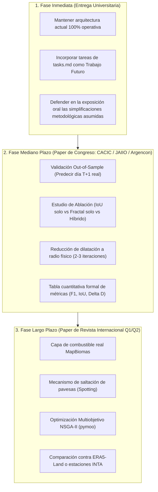

# Hoja de Ruta y Tareas de Mejora Metodológica (`tasks.md`)

Este documento consolida las líneas de investigación, optimizaciones técnicas, herramientas y metodologías necesarias para elevar el proyecto desde su estado actual (excelente para una cátedra universitaria de grado) hacia un **artículo de investigación publicable en congresos o revistas científicas internacionales** (Scopus / IEEE / Springer).

---

## 1. Refactorización y Refinamiento del Preprocesamiento Satelital

### Contexto del Problema Actual
El preprocesamiento actual aplica **11 iteraciones de dilatación morfológica** (`scipy.ndimage.binary_dilation`) y conserva únicamente el **componente conectado principal**, descartando el resto.
- **Limitación física:** En una grilla de $256 \times 256$ sobre Corrientes (~400 km de cobertura), cada celda mide $\approx 1.56 \text{ km}$. Dilatar 11 veces expande cada foco satelital en un radio de $\approx 17 \text{ km}$ ($>30 \text{ km}$ de diámetro). Esto fusiona artificialmente focos independientes y distorsiona el área quemada real.
- **Causa técnica:** La función `extraer_perimetro` utiliza `binary_erosion`. Para que la erosión no destruya los píxeles, necesita masas sólidas continuas de más de 2 píxeles de espesor.

### Tareas a Implementar
- [ ] **T1.1: Reducción de Dilatación a Radio Físico Justificado ($2$ a $3$ iteraciones)**
  - *Fundamento:* Justificar la dilatación en el paper como el **radio de transporte convectivo de pavesas** (*fire spotting*, típicamente de 1.5 a 4 km en incendios extremos con vientos de 30-50 km/h).
  - *Herramientas:* `scipy.ndimage.binary_dilation`, `skimage.morphology.disk`.
- [ ] **T1.2: Filtrado por Masa Crítica en vez de Componente Único**
  - *Fundamento:* Reemplazar la selección del "Top 1" con un umbral de significancia estadística: conservar todos los frentes conexos con tamaño mayor a $k$ celdas (ej. $k \ge 3$ celdas, descartando únicamente falsos positivos o ruido instrumental del sensor VIIRS).
  - *Herramientas:* `scipy.ndimage.label`, `pandas`.
- [ ] **T1.3: Construcción de Envolturas Cóncavas (*Alpha Shapes / Concave Hull*)**
  - *Fundamento:* En lugar de dilatación en cuadrícula discreta, agrupar nubes de puntos mediante cascos cóncavos con parámetro $\alpha$ calibrado, preservando hendiduras y vacíos topológicos naturales (lagunas, bañados).
  - *Librerías recomendadas:* `alphashape` (`pip install alphashape`), `shapely.ops.unary_union`, `scipy.spatial.Delaunay`.
- [ ] **T1.4: Estimación de Densidad por Kernel (KDE) y Umbralización Isopleta**
  - *Fundamento:* Generar una superficie continua de intensidad de fuego $f(x, y)$ a partir de la Potencia Radiativa del Fuego (**FRP**, *Fire Radiative Power*, presente en el dataset de la NASA) y definir el frente como una curva de nivel de densidad crítica.
  - *Librerías recomendadas:* `scipy.stats.gaussian_kde`, `scikit-learn` (`KernelDensity`).
- [ ] **T1.5: Box-Counting Directo sobre Conjuntos Dispersos (Polvos Fractales)**
  - *Fundamento:* Modificar el cálculo fractal para que opere sobre las celdas activas sin necesidad de "rellenar" artificialmente el interior para luego erosionarlo. La dimensión de Minkowski-Bouligand es válida para cualquier conjunto acotado no vacío en $\mathbb{R}^2$.

---

## 2. Complejidad Biofísica del Autómata Celular

### Contexto del Problema Actual
El simulador asume actualmente:
1. Una carga de combustible homogénea en toda la provincia (un único escalar optimizado por el AG).
2. Propagación estrictamente adyacente (vecindad de Moore de 8 celdas).
3. Viento constante y estático a lo largo de toda la corrida.

### Tareas a Implementar
- [ ] **T2.1: Capa Raster de Cobertura de Suelo y Biomasa Real (Heterogeneidad Espacial)**
  - *Fundamento:* En Corrientes coexisten pastizales secos, bosques implantados de pino/eucalipto (altamente combustibles), monte nativo y esteros inundables (resistencia infinita al avance).
  - *Dataset abierto:* **MapBiomas Chaco / Argentina** o **ESA WorldCover 10m**.
  - *Implementación:* Rasterizar la cobertura a $256 \times 256$ clasificando en 4 categorías:
    1. Cuerpos de agua y esteros profundos ($C = 0.0$, incombustible).
    2. Bañados y vegetación hidrófila ($C = 0.2$).
    3. Pastizales y sabanas ($C = 0.6$).
    4. Plantaciones forestales resinosas ($C = 1.0$).
  - *Librerías recomendadas:* `rasterio`, `geopandas`, `rioxarray`.
- [ ] **T2.2: Mecanismo Estocástico de Focos Secundarios por Pavesas (*Spotting Effect*)**
  - *Fundamento:* En incendios forestales severos, el avance no es solo por contacto térmico directo; las pavesas incandescentes vuelan cientos de metros impulsadas por el viento.
  - *Implementación:* Añadir una probabilidad $P_{\text{spot}} \ll P_{\text{ignición}}$ de encender celdas a distancia euclidiana de 2 a 5 celdas en el cono orientado a favor del viento.
- [ ] **T2.3: Pendiente Topográfica (Modelo de Rothermel / McArthur)**
  - *Fundamento:* El fuego avanza mucho más rápido cuesta arriba. Aunque Corrientes es mayoritariamente plana, las lomadas arenosas del centro y barrancas del Paraná influyen en los frentes.
  - *Dataset abierto:* **SRTM 30m (NASA Shuttle Radar Topography Mission)** o **Copernicus DEM GLO-30**.
  - *Fórmula:* Factor de pendiente $\phi_s = 5.275 \cdot (\tan \psi)^2$.
- [ ] **T2.4: Vectores de Viento Dinámicos por Franja Horaria**
  - *Fundamento:* El viento no es constante durante 72 horas.
  - *Implementación:* Permitir que el AC cargue un vector de viento variable para cada bloque de 24h, o acoplarlo con datos de reanálisis meteorológico horario (**ERA5-Land** de ECMWF).

---

## 3. Metodología de Validación Científica para Paper

Esta sección representa el **núcleo obligatorio** exigido por los revisores pares (*peer review*) de cualquier revista o congreso.

### Tareas a Implementar
- [ ] **T3.1: Validación Fuera de Muestra (*Out-of-Sample Validation / Walk-Forward*)**
  - *Diseño experimental:*
    1. **Entrenamiento:** Calibrar el AG con los datos de los días $T_0$ a $T_k$ (ej. 17 al 19 de febrero de 2022).
    2. **Inferencia Prospectiva:** Generar la predicción a $+24\text{h}$, $+48\text{h}$ y $+72\text{h}$.
    3. **Evaluación Ciega:** Comparar celda a celda la predicción contra las imágenes satelitales **reales** del 20, 21 y 22 de febrero (que el AG jamás vio durante su optimización).
- [ ] **T3.2: Batería Formal de Métricas Espaciales y Morfológicas**
  - Calcular e informar en tablas para cada horizonte ($24\text{h}, 48\text{h}, 72\text{h}$):
    - **IoU / Índice de Jaccard:** $\frac{|A_{\text{pred}} \cap A_{\text{real}}|}{|A_{\text{pred}} \cup A_{\text{real}}|}$
    - **Coeficiente Dice / F1-Score Espacial:** $\frac{2 |A_{\text{pred}} \cap A_{\text{real}}|}{|A_{\text{pred}}| + |A_{\text{real}}|}$
    - **Precisión y Sensibilidad (Recall):** Evaluación de falsos positivos y falsos negativos de avance.
    - **Distancia de Hausdorff Modificada:** Máxima discrepancia entre las fronteras de ambos perímetros.
    - **Error Absoluto de Dimensión Fractal:** $\Delta D = |D_{\text{real}} - D_{\text{pred}}|$.
  - *Librerías recomendadas:* `scikit-learn.metrics`, `scipy.spatial.distance.directed_hausdorff`.
- [ ] **T3.3: Estudio de Ablación (*Ablation Study*)**
  - Demostrar formalmente por qué la dimensión fractal es un aporte novedoso. Comparar tres configuraciones idénticas del AG:
    1. **Modelo A (Solo IoU):** $w_{\text{IoU}} = 1.0, w_{\text{fractal}} = 0.0$.
    2. **Modelo B (Solo Fractal):** $w_{\text{IoU}} = 0.0, w_{\text{fractal}} = 1.0$.
    3. **Modelo Propuesto (Híbrido):** $w_{\text{IoU}} = 0.5, w_{\text{fractal}} = 0.5$.
  - *Hipótesis a validar en el paper:* El modelo solo con IoU genera frentes lisos y geométricamente irreales que inflan el área; el modelo solo fractal dispersa la forma; el modelo híbrido preserva tanto la localización cardinal como la rugosidad física real del frente.
- [ ] **T3.4: Comparación contra Datos Meteorológicos Reales (Ground Truth Climático)**
  - Contrastar las variables inferidas por el AG (velocidad, dirección del viento y humedad) contra los registros de las estaciones meteorológicas del **INTA (Instituto Nacional de Tecnología Agropecuaria)** en Corrientes (ej. estación Mercedes o Bella Vista) o del dataset **ERA5-Land**.

---

## 4. Optimización Evolutiva Avanzada

### Contexto del Problema Actual
El AG actual implementa un algoritmo genético canónico con codificación real, torneo determinista, cruce en un punto y mutación uniforme.

### Tareas a Implementar
- [ ] **T4.1: Algoritmo Genético Multiobjetivo (Frente de Pareto)**
  - *Fundamento:* En vez de combinar linealmente con pesos fijos ($0.5 \cdot \text{Fractal} + 0.5 \cdot \text{IoU}$), formular el problema como optimización biobjetivo:
    $$\max f_1(\vec{x}) = \text{IoU}(\vec{x}), \quad \max f_2(\vec{x}) = F_{\text{fractal}}(\vec{x})$$
  - Utilizar **NSGA-II** (*Non-dominated Sorting Genetic Algorithm II*) para obtener el frente de Pareto de soluciones no dominadas y analizar el compromiso entre precisión espacial y complejidad morfométrica.
  - *Librerías recomendadas:* `pymoo` (`pip install pymoo`), `deap`.
- [ ] **T4.2: Operadores Genéticos Específicos para Valores Reales**
  - Reemplazar el cruce en 1 punto por **SBX** (*Simulated Binary Crossover*) y la mutación uniforme por **Mutación Polinomial**, ampliamente probadas para paisajes continuos en optimización inversa.
- [ ] **T4.3: Semillas Aleatorias y Análisis de Repetibilidad**
  - Ejecutar al menos 10 o 30 corridas independientes del AG con semillas aleatorias distintas (`random_state`) para reportar medias, desviaciones estándar e intervalos de confianza del 95% en los parámetros inferidos.

---

## 5. Tabla Maestra de Librerías, Datos y Herramientas Recomendadas

| Dominio | Herramienta / Librería | Propósito en el Proyecto |
|---|---|---|
| **GIS & Teledetección** | `rasterio` / `rioxarray` | Lectura y recorte de capas GeoTIFF de cobertura vegetal y elevación. |
| **GIS & Geometrías** | `geopandas` / `shapely` | Manipulación de geometrías vectoriales provinciales y departamentales (ya en uso). |
| **Geometría Cóncava** | `alphashape` | Generación de polígonos cóncavos ajustados a los focos de calor sin dilatación excesiva. |
| **Tratamiento de Imagen** | `scikit-image` (`skimage`) | Métricas morfológicas, esqueletización, componentes conexos y texturas. |
| **Cobertura de Suelo** | **MapBiomas Argentina / Chaco** | Capas raster gratuitas de uso y cobertura del suelo (resolución 30m). |
| **Topografía** | **NASA SRTM 30m / Copernicus DEM** | Modelos digitales de elevación para cálculo de pendientes. |
| **Clima de Referencia** | **ERA5-Land (Copernicus CDS)** | Reanálisis meteorológico horario para contrastar las inferencias del AG con el clima real. |
| **Métricas de Evaluación** | `scikit-learn` | Cálculo de matrices de confusión espaciales, F1-score, Precision, Recall e IoU. |
| **Distancia Espacial** | `scipy.spatial` | Distancia de Hausdorff y diagramas de Voronoi. |
| **Optimización Avanzada**| `pymoo` o `deap` | Implementación de NSGA-II multiobjetivo y operadores genéticos avanzados. |

---

## 6. Cronograma de Priorización y Fases de Trabajo

---

### Resumen Ejecutivo para la Presentación Universitaria
En el informe de la materia y en la exposición oral, la inclusión de este diagnóstico demuestra **madurez científica**:
1. *Reconocer que la dilatación de 11 pasos es un recurso computacional de aproximación para conectar focos.*
2. *Explicar que la física real del fuego se beneficiará con capas de combustible heterogéneas y validación fuera de muestra.*
3. *Mostrar que el pipeline actual sienta las bases de un framework completo y extensible para modelado prospectivo de catástrofes naturales.*

